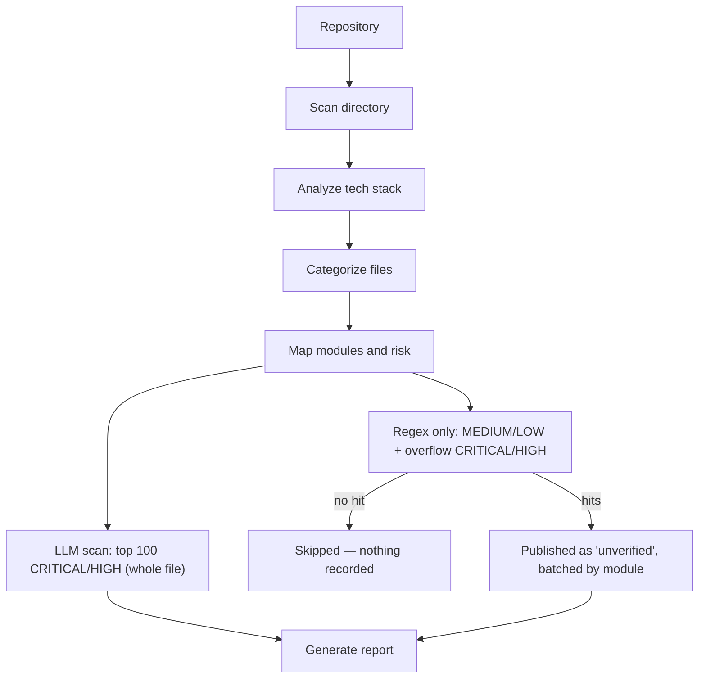

# SAST Engine

LangGraph agent: maps a repo's structure, tech stack, and file-level risk,
then runs vulnerability detection.



1. **Scan directory** — walk the repo (or scoped subdirectory), list files,
   record extension/language, size, and depth. Skips generated/vendor dirs
   (`node_modules`, `target`, `.venv`, etc.).
2. **Analyze tech stack** — three deterministic, LLM-free evidence passes,
   no LLM call in this step at all:
   1. **Marker-file heuristic** — which build tool is present, from
      dependency-manifest filenames (`pom.xml`, `package.json`,
      `requirements.txt`, `go.mod`, `Gemfile`, `composer.json`,
      `Cargo.toml`, `*.csproj`, ...).
   2. **Dependency-manifest scan** (`pipeline/dependency_scan.py`) — parses
      the actual declared dependencies in those manifests
      (`pipeline/manifest_parsers.py`) and matches them against a curated
      framework signature table (`pipeline/stack_signatures.py`) to name
      the real frameworks in use. This works for *any* ecosystem the
      marker heuristic recognizes — Java, Node, Python, Go, Ruby, PHP,
      .NET, Rust — not just the two the AST pass below can structurally
      parse. This is what correctly identifies non-Spring Java stacks
      (JAX-RS/RESTEasy, EJB, Struts, Axis2 SOAP, Drools, ...), which score
      zero on the Spring-only AST pass but still declare real, parseable
      dependencies. A few frameworks are config-file-driven rather than
      just dependency-driven (Struts' `struts-config.xml`, Axis2's
      `*.wsdl`); the dependency scan corroborates those with a small
      deterministic file-presence check when the corroborating file is
      also found in the scan.
   3. **Tree-sitter AST pass** (`ast_struct.py`) — parses real Java/Angular
      source for annotation/decorator usage, REST entry points, and
      Angular route-guard coverage. Covers Spring-style annotations and
      Angular decorators only — the two stacks with conventions rich
      enough for structural parsing to pay off; every other ecosystem's
      "what's really in use" story comes entirely from the dependency
      scan above.

   Confidence is layered across all three passes: a bare marker-file match
   is `low`/`medium`, a recognized dependency or real AST signal raises it
   to `medium`/`high`, and dependency evidence corroborated by an actual
   config file (or genuine AST structural evidence) is `high`.
3. **Categorize files** — buckets every file into source / config /
   dependency / test / build / other, using per-stack rule profiles (Maven,
   Angular, .NET, Python, Node) with a generic fallback for unrecognized
   stacks.
4. **Map modules and risk** — per-file risk level (CRITICAL / HIGH / MEDIUM /
   LOW) from path heuristics (auth/security code, DB/repository layers,
   runtime config, etc.) plus a peek at Java file heads (HTTP/SOAP entry
   points and servlet filters become CRITICAL, EJB interfaces LOW), and
   module boundary discovery (e.g. multi-module Maven builds). Test code —
   by directory or by name (`FooTest.java`, `*.spec.ts`, ...) — stays in
   Discovery but leaves both scan tiers.
5. **Deep LLM scan (top `DEEP_SCAN_FILE_CAP` CRITICAL / HIGH)** — the top 150
   CRITICAL/HIGH files by priority (CRITICAL first, then HIGH; once the call
   graph exists the set is re-picked by framework entry points, then typed
   sinks, per file — cap overridable via `deep_scan_file_cap`) are
   sent to the LLM in full, with the `rules/` catalog as prompt guidance (not
   a regex gate). Findings are written incrementally (`kind=llm`). This tier
   also owns the *absence* checks a regex cannot express — a missing
   `@PreAuthorize`, an unset `HttpOnly`, no CSRF token — since it sees the
   whole file, which is why the cap matters: only files that make it into
   this tier get absence-check coverage.

   Small files (under 6,000 characters) whose language's system prompt isn't
   prompt-cached share calls, up to 8 files / 16,000 characters each. "Not
   cached" means a non-Bedrock provider, or a prompt under the model's cache
   minimum (4,096 tokens on Haiku), which is typical for the TypeScript, HTML,
   XML and YAML prompts. Each finding names its `"file"`, and a failed batch
   falls back to one call per file (`scan_file_batch`,
   `--no-batch-small-files`). Declaration-only files never reach this tier.
   That covers Spring Data repository interfaces with derived queries only,
   and `.ts` files of only interfaces/types/enums
   (`llm_file_scan.looks_declaration_only`): they drop to LOW at risk mapping
   and the deep scan skips them.
6. **Regex triage (MEDIUM / LOW + overflow CRITICAL/HIGH)** — every file that
   didn't fit in step 5's cap joins MEDIUM/LOW here, keeping its true
   `risk_level` for reporting but losing the whole-file pass. `rules/` patterns
   run locally, and **that is the whole tier** — there is no LLM call. A file
   with zero hits is skipped entirely (no database write); every hit in a file
   that matches is written as a finding with `kind=regex` and
   **`verdict=unverified`** — a pattern matched, nobody reviewed it. Every file
   goes to one worker pool; batches (one per real module, else
   `triage_batch_size` slices) only report progress, each logging its "done"
   line when its last file finishes. Past 500 files the regex pass runs in
   worker processes, with the same findings.

   The mode is a toggle, not a hard-coding: `triage_mode` (`--triage-mode`)
   accepts `regex_only` (the default) or `llm_triage`, which restores the
   previous behaviour — hits plus a ±10-line window each go to the LLM for a
   TP/FP ruling, with `_hit_matches_finding` dropping anything the model invents
   outside the candidates it was handed.

   Files carrying a generated-code marker in their first 4000 characters
   (`@Generated`, `DO NOT EDIT`, "automatically generated", a Castor/JAXB
   banner) are skipped and counted separately — detection is by content, not by
   path, so hand-written files in the same directory are still scanned.
7. **Generate report** — TP/FP/unverified totals and counts by OWASP category.

MEDIUM is the largest tier in most repos — the Maven profile sends every
unclassified `src/main/java/` file there, Angular every bare `.ts` — which is
why it is regex-only: on a ~3000-file repo the local pass costs seconds where
per-file LLM round-trips cost hours. The tradeoff is that both recall *and*
precision in this tier come entirely from the catalog: anything no pattern
describes is not reported, and a noisy pattern produces noisy `unverified`
findings with nothing downstream to filter them.

Bedrock scans keep a **$3 spend cutoff** (`LLM_COST_CUTOFF_USD`): once
estimated Bedrock cost reaches $3, remaining calls in that scan continue on
fallback Ollama. Both finding stages share one usage dict so the cutoff applies
across the whole run — though in the default `regex_only` mode step 6 makes no
LLM calls, so the deep scan is effectively the only spender.

## Parallel stages

API scans (limitation `parallel-scan-stages`, default on) and the CLI (unless
`--sequential`) run three stages side by side after runtime-rule derivation,
joining for grouping and confirmation:

```
derive_runtime_rules -> fan_out -> flows (discover -> verify)
                                -> scan_deep_files
                                -> scan_triage_files
                     -> corroborate_flows -> group_triage_findings -> confirm_triage_groups
                     -> generate_report
```

This cuts wall-clock time, not tokens. The LLM cutoff is split into reserved
shares (deep 55%, flows 10%, triage/confirm 35%); a stage that finishes under
its share releases the rest. All provider calls share one concurrency limit
(`LLM_MAX_CONCURRENCY`, default 8) that halves on throttling, and throttled
calls back off with jitter. Each stage's log lines are prefixed
`[[stage:<name>]] ` so progress and the UI can tell them apart.

## Reachability evidence (`corroborate_flows`)

`pipeline/reachability.py` turns flow discovery into evidence for findings
from the *other* tiers. `discover_flows` indexes every path by its sink
(file, line) as `state["reachability_index"]` — every call-graph flow, taken
**before** the verify cap, so evidence the flow stage didn't spend LLM calls
on isn't lost. `corroborate_flows` runs right after the
stages join. It matches deep-scan and regex-triage findings to a
sink in the same file within ±2 lines whose kind fits the finding's CWE
(`SINK_KIND_CWES`; a finding with no CWE never matches), and stores the best
match on `finding["reachability"]` (persisted as `Finding.reachability`).

| status | from | meaning | effect |
|---|---|---|---|
| `path` | taint trace (Java) | the entry's input is passed through each call's arguments into the sink call's dangerous argument | raises a `true_positive` to 0.9 |
| `sanitized_path` | taint trace (Java) | the same, but only through a library encoder suited to that sink | attached; CVSS `AC:H` |
| `entry_reachable` | call graph | an entry point calls down to the sink's method; doesn't show which value | attached only |

`path` and `sanitized_path` come from `pipeline/taint_flows.py` (below); scans
made before the code-property-graph stage was removed hold them too.

### Argument-level taint (`taint_flows`)

`discover_flows` proves only that methods call each other. Before collapsing
and capping, `node_discover_flows` runs `taint_flows.annotate_flows` over every
Java flow (limitation `taint-flow-tracking`, CLI `--no-taint-flows`). Each
method gets one summary: parameters are symbolic labels, request accessors
(`request.getParameter(..)`, ...) are sources, and a flow-insensitive fixpoint
over assignments, `+=`, builder/collection mutation, for-each and lambda
parameters labels every call's arguments. Number/boolean/enum/UUID
conversions kill a label and known library encoders mark it — counted only
against the sink kinds the encoder defends (HTML escaping before a SQL query
leaves the flow a `path`). Composition then
substitutes labels hop by hop through the edge call's argument positions and
reads the sink's dangerous argument (the SQL text, not `JdbcTemplate`'s bound
values; the receiver for `ps.executeQuery()`). Entry parameters are untrusted
unless their type cannot carry text (`Long`, `HttpServletResponse`, `Model`,
...); for a public-API entry only its string-like parameters are untrusted.

The result (`flow.taint`) is `path`, `sanitized_path`, `unknown` (a field, an
untyped lambda, a call it could not locate — never treated as safe) or
`no_path`. Flows are re-sorted in that order (stable), `no_path` flows are
left out of LLM verification but stay in the reachability index as
`entry_reachable`, and a traced flow's verify prompt carries a one-paragraph
`Taint analysis` note naming the path. Propagation is generous on purpose (a
call's result carries its arguments' and receiver's labels), so the error it
makes is calling a flow `path` that is not, never dropping one that is.

Evidence only adds. A finding with no chain is never dropped and its
confidence is never lowered, because the call graph doesn't model every
framework's sources. Because corroboration runs before
`confirm_triage_groups`, grouped confirmation picks the occurrence with the
strongest evidence as the group's representative and adds the path to that
prompt (`render_evidence`). The call graph produces `entry_reachable`
evidence on Java/Python repos; without a call graph the node is a no-op. The UI shows the path on the finding card, and the PDF/Excel exports
add it to the data-flow text.

## Per-occurrence decisions

Every finding is decided as one concrete occurrence before it is grouped; no verdict is copied between occurrences that differ.

* **Facts** (`pipeline/occurrence_facts.py`): tree-sitter facts for a finding — enclosing method, the call at the anchor, receiver type, argument kinds, declaration/stub/comment flags. Java and TypeScript; `None` (and old behaviour) when unavailable. `finding_facts.prepare_findings` attaches them, then runs the validators.
* **Validators** (`pipeline/validators/`): deterministic checks with a fixed precedence against the model verdict (negative proof → false positive; positive fact vs. a dismissal → unresolved `conflict`; evidence gap → unresolved). Switch: `--no-occurrence-validators` / scan limitation `occurrence-validators`.
* **Publish filters, dedupe, group keys, per-member confirmation, explanation check**: described in the repository `CLAUDE.md` under *Per-occurrence decisions (EPIC-01)*. Entry points: `llm_file_scan.publish_decision`, `merge_dedupe`, `group_key_for_finding`, `confirm_finding_group` / `confirm_finding_group_batch`, `explanation_check.annotate`.
* Counters land in `usage_summary` (`validators`, `publish_filter`, `dedupe_conflicts`, `explanation_contradictions`, `group_confirm_coverage`, `facts_coverage`).

## SQL semantics

CWE-89 findings are decided from the statement they point at (`pipeline/sql_semantics.py`, `validators/sql_binding.py`): which query a JDBC statement was prepared with, whether it is fixed text, whether every placeholder is bound on every path. Fixed text with every value bound is a negative proof (`sql_fixed_template_bound`); a number concatenated into SQL is `quality` (`sql_numeric_only`); string-built text, including a stored string reused as SQL (`sql_second_order`), is a positive fact. Helpers, facades, generated DAOs and field-held batch statements are judged from per-method summaries resolved by receiver and signature. `runtime-sink-sql-*` wrapper rules are derived only for methods whose parameter reaches SQL text and are keyed by owner and signature (`wrapper_call_identity` checks each call). Unsafe SQL in a provably unreferenced private method is a true positive with `issue_class=inactive`. Details: the repository `CLAUDE.md`, *SQL semantics (EPIC-02)*; counters in `usage_summary.validators` and `usage_summary.sql_summaries`; entry points and parse coverage are logged at the call-graph step.

## Log and output sinks

Log forging, stdout-as-XSS and Angular render context are decided from the resolved call (`pipeline/output_sinks.py` classifies the receiver: logger, process stream, HTTP response writer, other, unknown), by validators that never dismiss on a name. `log_call_boundary` reads the logger call's own arguments (the regex only generates candidates), `log_value_domain` proves constant/numeric/enum arguments cannot forge a line, `log_exception_provenance` (`pipeline/exception_provenance.py`) works out what text a caught exception can carry from the catch types, the repository's construction sites and a small JDK table, and `log_layout` (`pipeline/logging_config.py`) reads the repository's logback/log4j/JUL configuration to see whether the appender neutralises CR/LF (a missing configuration is a note, not a gap). `servlet_output_sink` makes XSS require a real response writer and a request-derived value; `angular_render_context` follows a translation or component property into its template. Answers can be scoped to a CWE (`applies_to_cwe`), and counters are under `usage_summary.validators` and `usage_summary.exception_summaries`. The `.jsp` scriptlets are read through `pipeline/jsp_scriptlets.py`. See the root `CLAUDE.md` § Log and output sinks.

## Ripgrep catalog prefilter

`pipeline/rg_prefilter.py` (limitation `ripgrep-catalog-prefilter`, on by
default for API scans; `--catalog-prefilter` on the CLI): rg narrows which
(file, rule) pairs the Python catalog pass checks, using a literal every match
must contain (taken from Python's own regex parse). Python stays the authority,
so findings are identical either way. Searches batch up to eight literals
with the same case mode per invocation. Each rule receives the union of its
batch's candidate files; Python checks the actual pattern. A failed or
truncated batch leaves every rule in that batch on the full Python pass.
This trades broader candidate sets for fewer process launches and directory
walks. On a local 1,000-file / 9 MB sample, the 185-rule catalog needed 15
searches instead of 111: prefilter time fell from 3.4–4.3s to 0.6–0.7s,
and prefilter plus regex time from 5.2–5.7s to 2.5–4.3s with identical hits.
These are local sample timings, not full-scan estimates; the plain regex
pass can still be faster on small repositories.

rg runs through `pipeline/rg_runner.py`: patterns go in as `--regexp=`, globs
are repo-confined and relative, results are post-filtered to the inventory,
and size limits, a streamed 8 MB output cap and timeouts apply. Each rg runs
under `/bin/sh -c 'ulimit -v <kb>; exec "$0" "$@"'` (`RG_MEMORY_LIMIT_MB`,
default 2048), which Linux enforces and macOS treats as best-effort. An
abnormal rg exit is an error (or truncation), never "no matches". The binary
comes from the pinned `ripgrep` wheel in requirements.txt; `RG_PATH`
overrides it.

The agentic hunt (`pipeline/hunt/`, node `hunt_security`, learned rules) was
removed. Old scans can still hold `kind=hunt` findings, and
`scan_runner.reconcile_unverified_findings` skips them because their
`unverified` is an evidence cap.

Offline tests: `tests/test_rg_runner.py`, and `tests/test_rg_prefilter.py`
against `tests/fixtures/java_corpus`.

## Rule catalog and vulnerability surfaces

Patterns live in `rules/`, split per language, plus `rules/surfaces.json`
which maps detected stack signals to named vulnerability surfaces — the
`Tech Stack Detected -> Known Vulnerability Surface -> Targeted Regex` chain
the legacy audit docs in `regex_data/` spell out by hand, made reproducible
for any repo. Active surfaces are logged during step 2 and sort their rules to
the front of the prompt catalog; they never gate a rule.

Rules can also carry `requires_dependency`, so a pattern fires only when the
vulnerable library is actually declared (`implements Serializable` matters
because commons-collections < 3.2.2 is on the classpath, not on its own).
Unknown versions fail open. See `rules/README.md` for the full field
reference.

Standalone CLI runs may optionally persist JSON + SQLite after the graph
finishes; API-driven scans never write local files.

## Output shape

`{"scan": ..., "llm_analysis": ..., "categorized": ..., "module_plan": ..., "report": ...}` —
see `agent_bridge.run_real_scan` for how this is slimmed into the `discovery`
dict stored on `Scan.metadata_json`.

## CLI

```
python sast_scan_agent.py --path /path/to/project
python sast_scan_agent.py --path /path/to/project --no-llm
python sast_scan_agent.py --path /path/to/project --llm-provider ollama --llm-model granite-code:3b-instruct
python sast_scan_agent.py --path /path/to/project --sequential   # one stage at a time
python sast_scan_agent.py --path /path/to/project --llm-provider openai_compat \
    --llm-base-url http://localhost:8000/v1 --llm-model Qwen/Qwen2.5-Coder-32B-Instruct
```

## LLM backends

- **bedrock** — Claude on AWS Bedrock (default preset: Haiku 4.5)
- **openai_compat** — any OpenAI-compatible `/chat/completions` server (vLLM,
  LM Studio, llama.cpp server, OpenAI, ...). Base URL/API key per scan via
  `init_usage(provider_options=...)` (projects: `llm_base_url`/`llm_api_key`),
  else `OPENAI_COMPAT_BASE_URL`/`OPENAI_COMPAT_API_KEY`. JSON mode sends
  `response_format`, dropped (and remembered per endpoint) when a server
  rejects it; a leading `<think>` block is stripped. Priced at
  `OPENAI_COMPAT_INPUT/OUTPUT_PRICE_PER_MTOK` (default 0 — local).
- **claude_cli** — the local `claude` CLI, one `claude -p` subprocess per call
  and one persisted Claude session per scan (`provider_options["claude_cli"]` =
  `{session_id, workdir}`; first call `--session-id`, later calls `--resume`,
  serialized by a per-session lock). Runs with no tools/settings/MCP in an empty
  workdir; the stage's system text rides on the stdin message. Model is a CLI
  id (`claude-sonnet-5-5`, `claude-haiku-5-5`; the short aliases `sonnet`/`haiku` are pinned to those). `CLAUDE_CLI_PATH`, `CLAUDE_CLI_MODEL`,
  `CLAUDE_CLI_REQUEST_TIMEOUT`. Cost is notional (Sonnet/Haiku rates). Without a
  session id (`--llm-provider claude_cli` from the engine CLI) calls are ephemeral.
- **openai_cli** — a local OpenAI-model CLI, one `exec --json` subprocess per call
  and one thread per scan. The CLI chooses the thread id, so the first call's
  `thread.started` id is remembered in `_OPENAI_CLI_SESSIONS` (keyed by
  `provider_options["openai_cli"]["session_id"]`) and later calls run
  `exec resume <id>`, serialized by a per-session lock. Runs in a read-only
  sandbox in an empty workdir with the user's config and rules ignored; unlike
  `claude_cli` it cannot be given no tools, so the message tells the model not to
  use them (a prompt-injected file could still make it read files on disk).
  Models: `gpt-5.6-sol` (default), `gpt-6-astra`, `gpt-5.6-terra`, `gpt-5.6-luna`.
  `CODEX_CLI_PATH`, `OPENAI_CLI_MODEL`, `CODEX_CLI_REQUEST_TIMEOUT`,
  `OPENAI_CLI_REASONING_EFFORT` (default `medium`),
  `OPENAI_CLI_INPUT_PRICE_PER_MTOK` / `OPENAI_CLI_OUTPUT_PRICE_PER_MTOK` (notional
  placeholders, not published rates). Without a session id calls are ephemeral
  (`--ephemeral`). Each resumed call re-sends the thread so far, so input tokens
  grow across a scan.
- **ollama** — local models at `OLLAMA_BASE_URL` (optional; nothing requires it)

All are reached through the shared `llm_client.call_llm`; an unknown provider
name raises rather than falling through to Bedrock. Tech-stack detection
(step 2) is fully deterministic. Past the soft spend cutoff, calls switch to
the configured fallback provider — default `none`, which raises
`LlmBudgetExhausted` so each stage records its remaining work as unverified.
`call_llm(meta_out=...)` reports one call's own tokens.

`call_llm` also owns the two token-saving mechanisms shared by every stage:

- **Bedrock prompt caching**: once the system prompt clears the model's
  minimum cacheable size (`should_cache_system_prompt`), it is sent with a
  `cache_control` checkpoint. Cache reads and writes are reported separately
  and only discount `cost_usd`; `input_tokens` stays the logical prompt size.
- **Result cache**: when the shared usage dict carries a cache object under
  `RESULT_CACHE_USAGE_KEY`, JSON-mode calls are answered from it on an exact
  prompt/model match, and complete responses are stored. The API attaches a
  per-project DB cache. The CLI attaches none.

Every array-returning prompt asks for an object envelope (`{"findings": [...]}`,
`{"decisions": [...]}`, `{"rules": [...]}`) so it agrees with JSON mode's `{`
prefill.
