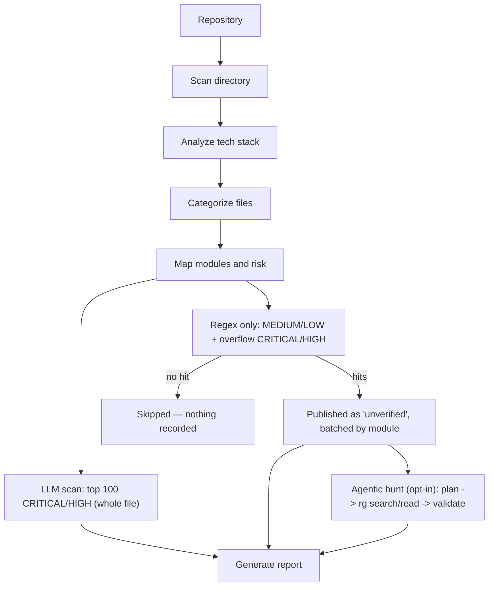

# SAST Engine

LangGraph agent: maps a repo's structure, tech stack, and file-level risk,
then runs vulnerability detection.



1. **Scan directory** — walk the repo (or scoped subdirectory), list files,
   record extension/language, size, and depth. Skips generated/vendor dirs
   (`node_modules`, `target`, `.venv`, etc.).
2. **Analyze tech stack** — three deterministic, LLM-free evidence passes,
   no LLM call in this step at all:
   1. **Marker-file heuristic** — which build tool is present, from
      dependency-manifest filenames (`pom.xml`, `package.json`,
      `requirements.txt`, `go.mod`, `Gemfile`, `composer.json`,
      `Cargo.toml`, `*.csproj`, ...).
   2. **Dependency-manifest scan** (`pipeline/dependency_scan.py`) — parses
      the actual declared dependencies in those manifests
      (`pipeline/manifest_parsers.py`) and matches them against a curated
      framework signature table (`pipeline/stack_signatures.py`) to name
      the real frameworks in use. This works for *any* ecosystem the
      marker heuristic recognizes — Java, Node, Python, Go, Ruby, PHP,
      .NET, Rust — not just the two the AST pass below can structurally
      parse. This is what correctly identifies non-Spring Java stacks
      (JAX-RS/RESTEasy, EJB, Struts, Axis2 SOAP, Drools, ...), which score
      zero on the Spring-only AST pass but still declare real, parseable
      dependencies. A few frameworks are config-file-driven rather than
      just dependency-driven (Struts' `struts-config.xml`, Axis2's
      `*.wsdl`); the dependency scan corroborates those with a small
      deterministic file-presence check when the corroborating file is
      also found in the scan.
   3. **Tree-sitter AST pass** (`ast_struct.py`) — parses real Java/Angular
      source for annotation/decorator usage, REST entry points, and
      Angular route-guard coverage. Covers Spring-style annotations and
      Angular decorators only — the two stacks with conventions rich
      enough for structural parsing to pay off; every other ecosystem's
      "what's really in use" story comes entirely from the dependency
      scan above.

   Confidence is layered across all three passes: a bare marker-file match
   is `low`/`medium`, a recognized dependency or real AST signal raises it
   to `medium`/`high`, and dependency evidence corroborated by an actual
   config file (or genuine AST structural evidence) is `high`.
3. **Categorize files** — buckets every file into source / config /
   dependency / test / build / other, using per-stack rule profiles (Maven,
   Angular, .NET, Python, Node) with a generic fallback for unrecognized
   stacks.
4. **Map modules and risk** — per-file risk level (CRITICAL / HIGH / MEDIUM /
   LOW) from path heuristics (auth/security code, DB/repository layers,
   runtime config, etc.), plus module boundary discovery (e.g. multi-module
   Maven builds).
5. **Deep LLM scan (top `DEEP_SCAN_FILE_CAP` CRITICAL / HIGH)** — the top 100
   CRITICAL/HIGH files by priority (CRITICAL first, then HIGH, in the order
   the risk rules encounter them — overridable via `deep_scan_file_cap`) are
   sent to the LLM in full, with the `rules/` catalog as prompt guidance (not
   a regex gate). Findings are written incrementally (`kind=llm`). This tier
   also owns the *absence* checks a regex cannot express — a missing
   `@PreAuthorize`, an unset `HttpOnly`, no CSRF token — since it sees the
   whole file, which is why the cap matters: only files that make it into
   this tier get absence-check coverage.
6. **Regex triage (MEDIUM / LOW + overflow CRITICAL/HIGH)** — every file that
   didn't fit in step 5's cap joins MEDIUM/LOW here, keeping its true
   `risk_level` for reporting but losing the whole-file pass. `rules/` patterns
   run locally, and **that is the whole tier** — there is no LLM call. A file
   with zero hits is skipped entirely (no database write); every hit in a file
   that matches is written as a finding with `kind=regex` and
   **`verdict=unverified`** — a pattern matched, nobody reviewed it. On large
   repos this tier runs in batches — one per real module when the repo has more
   than one, else fixed-size slices (`triage_batch_size`, default 250) — so
   results and progress surface incrementally instead of one pass over the whole
   repo; batches run strictly sequentially.

   The mode is a toggle, not a hard-coding: `triage_mode` (`--triage-mode`)
   accepts `regex_only` (the default) or `llm_triage`, which restores the
   previous behaviour — hits plus a ±10-line window each go to the LLM for a
   TP/FP ruling, with `_hit_matches_finding` dropping anything the model invents
   outside the candidates it was handed.

   Files carrying a generated-code marker in their first 4000 characters
   (`@Generated`, `DO NOT EDIT`, "automatically generated", a Castor/JAXB
   banner) are skipped and counted separately — detection is by content, not by
   path, so hand-written files in the same directory are still scanned.
7. **Generate report** — TP/FP/unverified totals and counts by OWASP category.

MEDIUM is the largest tier in most repos — the Maven profile sends every
unclassified `src/main/java/` file there, Angular every bare `.ts` — which is
why it is regex-only: on a ~3000-file repo the local pass costs seconds where
per-file LLM round-trips cost hours. The tradeoff is that both recall *and*
precision in this tier come entirely from the catalog: anything no pattern
describes is not reported, and a noisy pattern produces noisy `unverified`
findings with nothing downstream to filter them.

Bedrock scans keep a **$2 spend cutoff** (`LLM_COST_CUTOFF_USD`): once
estimated Bedrock cost reaches $2, remaining calls in that scan continue on
fallback Ollama. Both finding stages share one usage dict so the cutoff applies
across the whole run — though in the default `regex_only` mode step 6 makes no
LLM calls, so the deep scan is effectively the only spender.

## Joern (optional)

When [Joern](https://joern.io) is installed (`joern` / `joern-parse` on
`PATH`, or `JOERN_HOME` pointing at the install dir; JDK 17+), two extra
graph nodes use it. Without Joern both nodes log one line and do nothing, and
the scan behaves exactly as before.

- **`build_joern_cpg`** (after risk mapping) — `pipeline/joern_runner.py`
  builds one code property graph per dominant language (`joern-parse` handles
  one frontend per CPG; up to 3 languages with at least 3 files each; tests,
  vendored and build dirs excluded). The CPGs are shared by both uses below,
  so the parse cost is paid once.
- **Dataflow → flow verification** (`discover_flows`) — `joern/flows.sc`
  runs `reachableByFlows` from request inputs (Spring/JAX-RS entry params,
  servlet accessors, `request.args`, `req.body`, ...) to the sinks in
  `joern/taint_spec.json` (SQL, command, eval, file, SSRF, XSS, redirect,
  deserialization, XXE, LDAP, reflection, plus Joern-only response header,
  Spring `ResponseEntity` body and logger sinks). Framework-injected entry
  params (`HttpServletResponse`, `Model`, `Principal`, ...;
  `non_source_param_types`) are not sources. `pipeline/joern_flows.py` turns
  each path into the same `Flow` the tree-sitter call graph produces, plus
  `Flow.taint_path` (each expression the value passes through), which
  `flow_verify` adds to the LLM prompt. Each flow also carries the CPG's
  control dependence — `Flow.guards`, the conditions the path's nodes depend
  on, e.g. an `if (!id.matches("\\d+")) return` before the sink — and
  `Flow.sanitizers`, the taint-spec `sanitizers` calls the value passes
  through (scoped per sink kind: `parseInt` counts for SQL, not XSS). Both
  only annotate: no flow is dropped for them; the prompt lists them and
  sanitized flows rank last. `authenticated` comes from `@PreAuthorize`/
  `@Secured`/`@RolesAllowed` on the source method. Sink kinds run one at a
  time in `kind_order` (most severe first), `maxFlows` applies per kind, and
  the output file is rewritten after each kind, so a timeout returns the
  finished kinds (`complete: false`) instead of nothing. Header, response-body
  and log flows rank behind every other kind. Joern flows rank first, with up to a
  third of `FLOW_VERIFY_CAP` reserved for tree-sitter flows Joern didn't also
  find (e.g. Spring Data repository sinks). Single-file Joern flows in files
  the deep scan already reviewed are dropped. Because Joern isn't limited to
  Java/Python, this also gives JS/TS, C/C++, Go, PHP, ... repos flow
  verification.
- **`joern_scan`** (after regex triage) — `joern/queries.sc` runs structural
  queries a regex can't express (XML parser built with no hardening call in
  the same method, trust-all TrustManager/HostnameVerifier, non-literal C
  format string, unbounded libc copies, weak hash/cipher, cookie without
  Secure/HttpOnly, `shell=True`, Flask `debug=True`, hardcoded credentials).
  `pipeline/joern_findings.py` writes the hits as `kind=joern`,
  `verdict=unverified` findings and confirms them with the same grouped LLM
  confirmation regex hits use. This node runs the confirmation itself because
  `group/confirm_triage_groups` are skipped under `llm_triage`.

Every Joern failure (missing binary, timeout, bad exit, unreadable JSON)
degrades to "no Joern results" (or, for `flows.sc`, the kinds finished
before it) and never fails the scan. Joern runs with the session's temp dir
as its working directory, because `importCpg` copies each CPG into
`./workspace/` — run from the backend directory, those copies used to pile up
in `backend/workspace/` forever. Per-project
toggles are `joern-dataflow` and `joern-scan-queries` in
`app/defaults/scan_limitations.py`. CLI flags are `--no-joern`,
`--no-joern-dataflow`, `--no-joern-queries` and `--joern-timeout`. Backend
settings are `JOERN_HOME`, `JOERN_TIMEOUT_SEC` (default 900) and
`JOERN_JAVA_OPTS` (default `-Xmx4g`). Built against Joern 4.0.653. The
scripts use the `io.shiftleft`/`io.joern.dataflowengineoss` APIs, so
re-check them after a major Joern upgrade (`pytest -m live
tests/test_joern.py`).

## Agentic hunt (opt-in)

`pipeline/hunt/`, node `hunt_security` (after `joern_scan`). Off unless
`hunt_mode == "agentic"` — limitation `agentic-security-hunt` for API scans,
`--hunt` on the CLI — and a logged no-op without an LLM or without ripgrep.
The catalog pass stays the deterministic floor; the hunt adds what a fixed
pattern list can't express: cross-method, cross-file source-to-sink proof.

```
dossier (no LLM) -> planner (1 call) -> investigators (parallel) -> validator -> findings (kind=hunt)
```

- **Dossier** (`repo_index.py`): a bounded (~6k-token) summary standing in
  for the repo — stack, surfaces, entry points, per-kind sink inventory
  (call-graph resolved when the graph exists, else rg file counts),
  security-config files, catalog hit histogram, unconfirmed flows. The model
  never sees a file list.
- **Planner** (`planner.py`): deterministic seed hypotheses (every sink kind
  present, every unconfirmed flow, authz/CSRF surfaces) plus one LLM call to
  rank and extend them (`{"hypotheses": [...]}`), capped at 20. Seeds keep a
  floor when the planner fails.
- **Investigator** (`investigator.py`): one JSON action per turn over the
  read-only toolbox (`tools.py`: `search`, `search_sinks`, `search_sources`,
  `read`, `definition`, `callers`, `find_sanitizers`, `find_authz`,
  `list_files`, then `report`/`abandon`). The engine classifies every search
  — INVALID (rg's error + a fix hint), ZERO (one relaxed variant tried
  automatically), TOO_MANY (>300: totals and a module histogram only),
  NOISY (mostly comments/tests/generated: filtered and stated) — and keeps
  an evidence checklist the model can only update with lines a tool actually
  showed it. A `report` with gaps (a sink with no proven source/path, no
  sanitizer check, no authorization check) is refused as
  INSUFFICIENT_EVIDENCE with the missing items and the strategy to switch to;
  after that, or after 3 consecutive searches for something already
  established, further searches for it are blocked. Loop guards: pattern
  memo, 3 reformulations per intent, 14 steps per hypothesis, one corrective
  retry for a malformed action. The engine pre-runs the obvious first search
  so no LLM turn is spent on it.
- **Symbols** (`symbols.py`): Joern taint paths, then the tree-sitter
  CallGraph (built lazily over the Java inventory when the scan didn't build
  one), then rg — and rg results are labelled `textual` and never count as
  proof.
- **Validator** (`validator.py`): grounding against the `EvidenceLedger`
  (every cited line must have been shown; quotes must match the file,
  redaction-aware) — else dropped. Evidence level L3 (Joern path), L2 (every
  hop graph-resolved or read in full within one method, request-accessor or
  entry-parameter source, known sink), L1 otherwise. L2/L3 candidates go to an
  independent verifier with no transcript (`flow_verify.verify_flows` for
  source->sink classes, `confirm_finding_group` for single-construct ones);
  `true_positive` needs L2/L3 *and* agreement, anything else is `unverified`
  with the reason. Dedupe is per finding (file, sink line +-2, CWE family)
  against every other tier — a CRITICAL-file finding the deep scan missed is
  published, one it found is counted as `corroborated`.
- **Budget/safety** (`budget.py`, `redact.py`, `rg_runner.py`): atomic
  reservations (worst-case cost reserved before each call, settled after) for
  USD, tokens, wall time, LLM and rg calls; the USD default is 30% of the
  scan's remaining cost cutoff. Secret values are masked before any code
  leaves the process (line-count preserving). Repository text reaches the
  model only inside `<untrusted_code>` blocks. rg runs with patterns as
  `--regexp=`, repo-confined relative globs, inventory post-filtering, size
  limits, a streamed 8 MB output cap and timeouts. Each rg runs under
  `/bin/sh -c 'ulimit -v <kb>; exec "$0" "$@"'` (`RG_MEMORY_LIMIT_MB`, default
  2048; args never pass through the script) — enforced on Linux, best-effort
  on macOS, reported as `report["hunt"]["rg_memory_limit_enforced"]`. An
  abnormal rg exit is an error (or truncation), never "no matches". The prebuilt `ripgrep`
  wheel (requirements.txt) has no PCRE2, so look-around patterns get a
  rewrite hint unless `RG_PATH` points at a PCRE2 build.
- **Scope**: seeds from `triage_scan_paths` (HIGH/MEDIUM/LOW), ranked HIGH
  first; traces and publishes anywhere in the inventory. Tests are
  deprioritized, generated files excluded; `--hunt-profile benchmark` (state
  `hunt_profile`) includes both, for OWASP Benchmark / Juliet layouts.
- **Report**: `report["hunt"]` — per-hypothesis status
  (confirmed/refuted/inconclusive/budget), strategy trail, searches and
  outcomes, evidence levels, dropped/corroborated counts, budget snapshot.
- **Learned rules** (`learned.py`): a model-written search that surfaced a
  confirmed TP sink becomes a candidate rule, promoted only if Python
  compiles it, it matches every sink it is credited with, it matches no
  refuted/verifier-disputed site, and its repo-wide match count stays under a
  noise ceiling. Rows (promoted/rejected with reasons) land in
  `report["hunt"]["learned_rules"]`; on a successful API scan,
  `scan_runner._remember_learned_rules` merges the promoted ones into
  `Project.learned_rules` (`app/services/learned_rules.py`: stable
  pattern-hash ids, deduped, newest 50), and later scans run them with the
  catalog (`state["learned_rules"]` -> `_learned_rules` in `_scan_context`;
  limitation `learned-hunt-rules`, default on; a pattern that no longer
  compiles or collides with a catalog id is skipped). Remove one with
  `DELETE /projects/{id}/learned-rules/{rule_id}`.
- `scan_runner.reconcile_unverified_findings` skips `kind=hunt`: their
  `unverified` is a deliberate evidence cap, not unfinished work.
- **Catalog prefilter** (`pipeline/rg_prefilter.py`, opt-in: limitation
  `ripgrep-catalog-prefilter` / `--catalog-prefilter`): rg narrows which
  (file, rule) pairs the Python catalog pass checks via a literal every match
  must contain (from Python's own regex parse); Python stays the authority and
  findings are identical. Off by default — measured slower on a ~1k-file repo
  (4.2s vs 1.8s) since one rg process per literal outweighs the saved work.

Offline tests: `tests/test_hunt_*.py` against `tests/fixtures/hunt_java`
(scripted LLM; rg and tree-sitter-java needed for the graph-resolved paths).

## Rule catalog and vulnerability surfaces

Patterns live in `rules/`, split per language, plus `rules/surfaces.json`
which maps detected stack signals to named vulnerability surfaces — the
`Tech Stack Detected -> Known Vulnerability Surface -> Targeted Regex` chain
the legacy audit docs in `regex_data/` spell out by hand, made reproducible
for any repo. Active surfaces are logged during step 2 and sort their rules to
the front of the prompt catalog; they never gate a rule.

Rules can also carry `requires_dependency`, so a pattern fires only when the
vulnerable library is actually declared (`implements Serializable` matters
because commons-collections < 3.2.2 is on the classpath, not on its own).
Unknown versions fail open. See `rules/README.md` for the full field
reference.

Standalone CLI runs may optionally persist JSON + SQLite after the graph
finishes; API-driven scans never write local files.

## Output shape

`{"scan": ..., "llm_analysis": ..., "categorized": ..., "module_plan": ..., "report": ...}` —
see `agent_bridge.run_real_scan` for how this is slimmed into the `discovery`
dict stored on `Scan.metadata_json`.

## CLI

```
python sast_scan_agent.py --path /path/to/project
python sast_scan_agent.py --path /path/to/project --no-llm
python sast_scan_agent.py --path /path/to/project --llm-provider ollama --llm-model granite-code:3b
python sast_scan_agent.py --path /path/to/project --no-joern
python sast_scan_agent.py --path /path/to/project --llm-provider openai_compat \
    --llm-base-url http://localhost:8000/v1 --llm-model Qwen/Qwen2.5-Coder-32B-Instruct \
    --llm-data-policy local_only --hunt
```

## LLM backends

- **bedrock** — Claude on AWS Bedrock (default preset: Haiku 4.5)
- **openai_compat** — any OpenAI-compatible `/chat/completions` server (vLLM,
  LM Studio, llama.cpp server, OpenAI, ...). Base URL/API key per scan via
  `init_usage(provider_options=...)` (projects: `llm_base_url`/`llm_api_key`),
  else `OPENAI_COMPAT_BASE_URL`/`OPENAI_COMPAT_API_KEY`. JSON mode sends
  `response_format`, dropped (and remembered per endpoint) when a server
  rejects it; a leading `<think>` block is stripped. Priced at
  `OPENAI_COMPAT_INPUT/OUTPUT_PRICE_PER_MTOK` (default 0 — local).
- **ollama** — local models at `OLLAMA_BASE_URL` (optional; nothing requires it)

All are reached through the shared `llm_client.call_llm`; an unknown provider
name raises rather than falling through to Bedrock. Tech-stack detection
(step 2) is fully deterministic. Past the soft spend cutoff, calls switch to
the configured fallback provider — default `none`, which raises
`LlmBudgetExhausted` so each stage records its remaining work as unverified.
A `local_only` data policy (`init_usage(data_policy=...)`) refuses Bedrock
and any non-localhost/private endpoint (`LlmPolicyViolation`); the API also
refuses such a scan at trigger time. `call_llm(meta_out=...)` reports one
call's own tokens — what the hunt budget settles on under concurrency.

`call_llm` also owns the two token-saving mechanisms shared by every stage:

- **Bedrock prompt caching**: once the system prompt clears the model's
  minimum cacheable size (`should_cache_system_prompt`), it is sent with a
  `cache_control` checkpoint. Cache reads and writes are reported separately
  and only discount `cost_usd`; `input_tokens` stays the logical prompt size.
- **Result cache**: when the shared usage dict carries a cache object under
  `RESULT_CACHE_USAGE_KEY`, JSON-mode calls are answered from it on an exact
  prompt/model match, and complete responses are stored. The API attaches a
  per-project DB cache. The CLI attaches none.

Every array-returning prompt asks for an object envelope (`{"findings": [...]}`,
`{"decisions": [...]}`, `{"rules": [...]}`) so it agrees with JSON mode's `{`
prefill.
