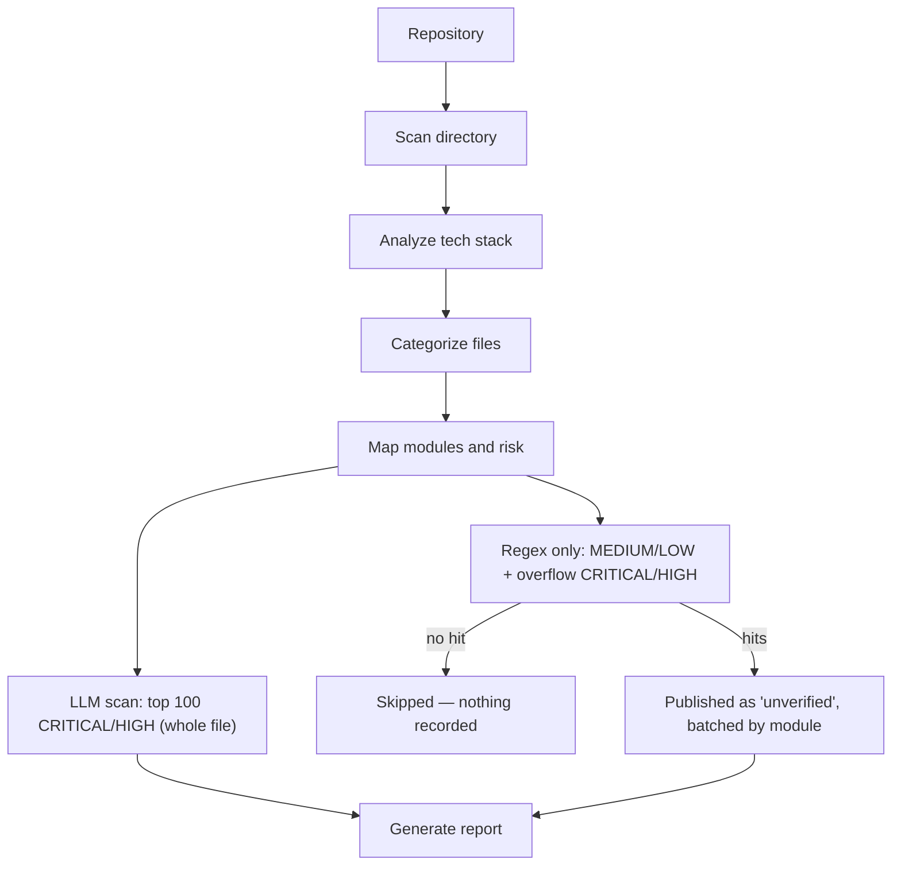

# SAST Engine

LangGraph agent: maps a repo's structure, tech stack, and file-level risk,
then runs vulnerability detection.



1. **Scan directory** — walk the repo (or scoped subdirectory), list files,
   record extension/language, size, and depth. Skips generated/vendor dirs
   (`node_modules`, `target`, `.venv`, etc.).
2. **Analyze tech stack** — three deterministic, LLM-free evidence passes,
   no LLM call in this step at all:
   1. **Marker-file heuristic** — which build tool is present, from
      dependency-manifest filenames (`pom.xml`, `package.json`,
      `requirements.txt`, `go.mod`, `Gemfile`, `composer.json`,
      `Cargo.toml`, `*.csproj`, ...).
   2. **Dependency-manifest scan** (`pipeline/dependency_scan.py`) — parses
      the actual declared dependencies in those manifests
      (`pipeline/manifest_parsers.py`) and matches them against a curated
      framework signature table (`pipeline/stack_signatures.py`) to name
      the real frameworks in use. This works for *any* ecosystem the
      marker heuristic recognizes — Java, Node, Python, Go, Ruby, PHP,
      .NET, Rust — not just the two the AST pass below can structurally
      parse. This is what correctly identifies non-Spring Java stacks
      (JAX-RS/RESTEasy, EJB, Struts, Axis2 SOAP, Drools, ...), which score
      zero on the Spring-only AST pass but still declare real, parseable
      dependencies. A few frameworks are config-file-driven rather than
      just dependency-driven (Struts' `struts-config.xml`, Axis2's
      `*.wsdl`); the dependency scan corroborates those with a small
      deterministic file-presence check when the corroborating file is
      also found in the scan.
   3. **Tree-sitter AST pass** (`ast_struct.py`) — parses real Java/Angular
      source for annotation/decorator usage, REST entry points, and
      Angular route-guard coverage. Covers Spring-style annotations and
      Angular decorators only — the two stacks with conventions rich
      enough for structural parsing to pay off; every other ecosystem's
      "what's really in use" story comes entirely from the dependency
      scan above.

   Confidence is layered across all three passes: a bare marker-file match
   is `low`/`medium`, a recognized dependency or real AST signal raises it
   to `medium`/`high`, and dependency evidence corroborated by an actual
   config file (or genuine AST structural evidence) is `high`.
3. **Categorize files** — buckets every file into source / config /
   dependency / test / build / other, using per-stack rule profiles (Maven,
   Angular, .NET, Python, Node) with a generic fallback for unrecognized
   stacks.
4. **Map modules and risk** — per-file risk level (CRITICAL / HIGH / MEDIUM /
   LOW) from path heuristics (auth/security code, DB/repository layers,
   runtime config, etc.), plus module boundary discovery (e.g. multi-module
   Maven builds).
5. **Deep LLM scan (top `DEEP_SCAN_FILE_CAP` CRITICAL / HIGH)** — the top 100
   CRITICAL/HIGH files by priority (CRITICAL first, then HIGH, in the order
   the risk rules encounter them — overridable via `deep_scan_file_cap`) are
   sent to the LLM in full, with the `rules/` catalog as prompt guidance (not
   a regex gate). Findings are written incrementally (`kind=llm`). This tier
   also owns the *absence* checks a regex cannot express — a missing
   `@PreAuthorize`, an unset `HttpOnly`, no CSRF token — since it sees the
   whole file, which is why the cap matters: only files that make it into
   this tier get absence-check coverage.
6. **Regex triage (MEDIUM / LOW + overflow CRITICAL/HIGH)** — every file that
   didn't fit in step 5's cap joins MEDIUM/LOW here, keeping its true
   `risk_level` for reporting but losing the whole-file pass. `rules/` patterns
   run locally, and **that is the whole tier** — there is no LLM call. A file
   with zero hits is skipped entirely (no database write); every hit in a file
   that matches is written as a finding with `kind=regex` and
   **`verdict=unverified`** — a pattern matched, nobody reviewed it. On large
   repos this tier runs in batches — one per real module when the repo has more
   than one, else fixed-size slices (`triage_batch_size`, default 250) — so
   results and progress surface incrementally instead of one pass over the whole
   repo; batches run strictly sequentially.

   The mode is a toggle, not a hard-coding: `triage_mode` (`--triage-mode`)
   accepts `regex_only` (the default) or `llm_triage`, which restores the
   previous behaviour — hits plus a ±10-line window each go to the LLM for a
   TP/FP ruling, with `_hit_matches_finding` dropping anything the model invents
   outside the candidates it was handed.

   Files carrying a generated-code marker in their first 4000 characters
   (`@Generated`, `DO NOT EDIT`, "automatically generated", a Castor/JAXB
   banner) are skipped and counted separately — detection is by content, not by
   path, so hand-written files in the same directory are still scanned.
7. **Generate report** — TP/FP/unverified totals and counts by OWASP category.

MEDIUM is the largest tier in most repos — the Maven profile sends every
unclassified `src/main/java/` file there, Angular every bare `.ts` — which is
why it is regex-only: on a ~3000-file repo the local pass costs seconds where
per-file LLM round-trips cost hours. The tradeoff is that both recall *and*
precision in this tier come entirely from the catalog: anything no pattern
describes is not reported, and a noisy pattern produces noisy `unverified`
findings with nothing downstream to filter them.

Bedrock scans keep a **$2 spend cutoff** (`LLM_COST_CUTOFF_USD`): once
estimated Bedrock cost reaches $2, remaining calls in that scan continue on
fallback Ollama. Both finding stages share one usage dict so the cutoff applies
across the whole run — though in the default `regex_only` mode step 6 makes no
LLM calls, so the deep scan is effectively the only spender.

## Rule catalog and vulnerability surfaces

Patterns live in `rules/`, split per language, plus `rules/surfaces.json`
which maps detected stack signals to named vulnerability surfaces — the
`Tech Stack Detected -> Known Vulnerability Surface -> Targeted Regex` chain
the legacy audit docs in `regex_data/` spell out by hand, made reproducible
for any repo. Active surfaces are logged during step 2 and sort their rules to
the front of the prompt catalog; they never gate a rule.

Rules can also carry `requires_dependency`, so a pattern fires only when the
vulnerable library is actually declared (`implements Serializable` matters
because commons-collections < 3.2.2 is on the classpath, not on its own).
Unknown versions fail open. See `rules/README.md` for the full field
reference.

Standalone CLI runs may optionally persist JSON + SQLite after the graph
finishes; API-driven scans never write local files.

## Output shape

`{"scan": ..., "llm_analysis": ..., "categorized": ..., "module_plan": ..., "report": ...}` —
see `agent_bridge.run_real_scan` for how this is slimmed into the `discovery`
dict stored on `Scan.metadata_json`.

## CLI

```
python sast_scan_agent.py --path /path/to/project
python sast_scan_agent.py --path /path/to/project --no-llm
python sast_scan_agent.py --path /path/to/project --llm-provider ollama --llm-model granite-code:3b
```

## LLM backends

- **bedrock** — Claude on AWS Bedrock (default preset: Haiku 4.5)
- **ollama** — local models at `OLLAMA_BASE_URL`

Both are reached through the shared `llm_client.call_llm`. Tech-stack
detection (step 2) is fully deterministic. File scanning (steps 5–6) uses
`call_llm`, including the soft Bedrock-spend cutoff / fallback-to-Ollama.
