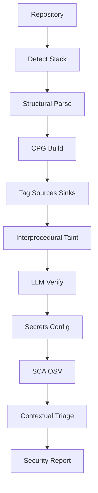

# How Scanning Works

This document explains the end-to-end scan lifecycle in Secure Build — from triggering a scan in the UI or CI, through the LangGraph **CPG + taint** SAST engine (OWASP Top 10 labeled), to persisted findings.

## Overview

Secure Build has **two ways** to run a scan:

| Entry point | When used |
|-------------|-----------|
| **HTTP API** (`POST /scans`) | UI, Jenkins, GitHub Actions, curl scripts |
| **CLI** (`sast_scan_agent.py`) | Standalone local scans, debugging the engine |

Both paths run the same **LangGraph pipeline** in `backend/sast_engine/sast_scan_agent.py`:

`prepare → detect_stack → structural parse → CPG build → tag → taint → verify → secrets → SCA → contextual triage → report`

Optional `RUN_REGEX_SCAN=1` appends the legacy OWASP regex canvas. The API path adds workspace management, database persistence, and scan logging on top.

```
┌─────────────┐     POST /scans      ┌──────────────┐     background thread
│  UI / CI    │ ──────────────────►  │ scans router │ ─────────────────────►
└─────────────┘                      └──────────────┘
                                            │
                                            ▼
                                     ┌──────────────┐
                                     │ scan_runner  │  queued → running → success/failed
                                     └──────────────┘
                                            │
                         ┌──────────────────┼──────────────────┐
                         ▼                  ▼                  ▼
                  git_workspace      engine_adapter      scan_log (JSONL)
                  (clone/checkout)   (mock or real)      data/scan_logs/
                                            │
                                            ▼
                                     ┌──────────────┐
                                     │ agent_bridge │  loads sast_scan_agent.py
                                     └──────────────┘
                                            │
                                            ▼
                             LangGraph CPG + taint (+ OWASP Top 10)
                                            │
                                            ▼
                                     Findings → SQLite DB
```

---

## Step 1 — Trigger a Scan (API)

**Endpoint:** `POST /scans`  
**Handler:** `backend/app/routers/scans.py` → `trigger_scan()`

1. **Validate project** — looks up `project_id` from the request body.
2. **Resolve git coordinates** — uses `git_url`, `branch`, and optional `commit_sha` from the payload, falling back to project defaults.
3. **Deduplicate (no-op)** — if no `commit_sha` is provided and `force` is false:
   - Resolves the remote HEAD for the branch via `git_workspace.resolve_remote_head()`
   - Checks whether a scan for that commit already exists with status `queued`, `running`, or `success`
   - If found, returns the existing scan (`reused: true`) instead of starting a new one
4. **Create scan row** — inserts a `Scan` record with:
   - Incremented `version` per project
   - LLM provider/model snapshot from the project
   - `triggered_by` (`app` or `jenkins`) derived from metadata
5. **Start execution** — calls `scan_runner.start_scan_background(scan_id)`
6. **Return 202** — `{ scan_id, status, status_url }`

Poll progress with `GET /scans/{id}/status` and tail logs with `GET /scans/{id}/logs?after=0`.

---

## Step 2 — Scan Runner

**File:** `backend/app/services/scan_runner.py` → `execute_scan()`

| Phase | Progress | What happens |
|-------|----------|--------------|
| Start | 10% | Status → `running`; snapshot LLM settings; reset scan log |
| Workspace | — | Clone or reuse git checkout (see Step 3) |
| Engine | — | Call `engine_adapter.run_scan()` |
| Persist | 70% | Insert `Finding` rows for each raw finding |
| Done | 100% | Status → `success` (or `failed` with `message`) |

**Threading behavior:**
- **Mock engine** — runs synchronously (tests get deterministic results)
- **Live engine** — runs on a daemon thread so the HTTP response returns immediately

---

## Step 3 — Git Workspace

**File:** `backend/app/services/git_workspace.py`

For the **real engine** (when `USE_MOCK_ENGINE=false` and `RUN_LIVE_SAST=1`):

1. Workspace path: `data/workspaces/{project_id}/`
2. `ensure_workspace()` clones or updates the repo to the requested branch/commit
3. On failure, the scan is marked `failed` with a checkout error message

The **mock engine** skips git entirely — tests pre-seed the workspace directory or leave it empty.

---

## Step 4 — Engine Adapter (Mock vs Real)

**File:** `backend/app/services/engine_adapter.py`

### Mock path (`USE_MOCK_ENGINE=true`, default for tests)

Returns two deterministic fake findings (SQL injection + hardcoded secret). No network, no LLM, no git.

### Real path (`USE_MOCK_ENGINE=false` + `RUN_LIVE_SAST=1`)

1. Requires a checked-out `workspace` on disk
2. Delegates to `agent_bridge.run_real_scan()`
3. Raises if `RUN_LIVE_SAST` is not set (safety gate against accidental Bedrock/git usage)

---

## Step 5 — Agent Bridge

**File:** `backend/app/services/agent_bridge.py`

Bridges the FastAPI app into the in-repo SAST agent:

1. **Load module** — dynamically imports `backend/sast_engine/sast_scan_agent.py`
2. **Sync env** — sets AWS region, Bedrock model, Ollama URL, and `RUN_SCA` / `RUN_REGEX_SCAN` flags from `app.config`
3. **Build initial state** from project settings:
   - `local_path` → workspace directory
   - `llm_provider` / `llm_model` (bedrock, claude_cli, openai_cli or ollama)
   - `scope` → monorepo/subdirectory limit
   - `enable_secrets` → gates the secrets/config stage
   - `run_dependency_scan` → gates SCA (`project.enable_sca` + `settings.run_sca`)
   - `run_regex_scan` → optional legacy OWASP regex fallback (`RUN_REGEX_SCAN`)
   - `flow_budget` / `max_hop_depth` — taint path caps
4. **Invoke LangGraph** — `agent.build_graph().invoke(initial_state)`
5. **Map findings** — converts engine output to DB schema including `owasp_category`, `flow_path`, `exploitability`, `root_cause_id`

---

## Step 6 — LangGraph Pipeline

**File:** `backend/sast_engine/sast_scan_agent.py`



```
START → prepare_repo → detect_stack → stage1_parse → cpg_build → stage2_tag
     → stage3_taint → stage4_verify → stage5_config → dependency_scan
     → regex_fallback → contextual_triage → generate_report → END
```

| Stage | LLM? | What happens |
|-------|------|--------------|
| `prepare_repo` | No | Clone/read repo, collect source + manifests |
| `detect_stack` (STEP 0) | Optional | Grep signals + LLM stack fingerprint; cached |
| `stage1_parse` (STAGE 1) | No | Tree-sitter → functions/calls into GraphStore |
| `cpg_build` (STAGE 1b) | No | CFG + DATA edges |
| `stage2_tag` (STAGE 2) | Optional | LLM + seed catalog for source/sink/sanitizer + OWASP |
| `stage3_taint` (STAGE 3) | No* | Interprocedural taint (*optional weight LLM) |
| `stage4_verify` (STAGE 4) | Yes | OWASP-aware taint-slice verdicts |
| `stage5_config` (STAGE 5) | Yes | Secrets/config → A02/A05 |
| `dependency_scan` (STAGE 5b) | No | OSV SCA → A06 |
| `regex_fallback` | No | Legacy OWASP regex if `RUN_REGEX_SCAN=1` |
| `contextual_triage` (STAGE 6) | No | Root-cause group + exploitability |
| `generate_report` (STAGE 7) | No | Report + `coverage.owasp_top10` |

Verdicts: `TRUE_POSITIVE` / `FALSE_POSITIVE` / `NEEDS_REVIEW`. Coverage includes per-category OWASP Top 10 counts.

See [backend/sast_engine/README.md](../backend/sast_engine/README.md) for env vars and CLI usage.

---

## Step 7 — Persist & Retrieve Results

Back in `scan_runner.execute_scan()`:

1. Each mapped finding is inserted as a `Finding` row linked to `scan_id`
2. Scan status → `success`, progress → 100%

**Retrieve results:**

| Endpoint | Purpose |
|----------|---------|
| `GET /scans/{id}/status` | `status`, `progress`, `message` |
| `GET /scans/{id}/logs` | Live engine log tail (JSONL) |
| `GET /scans/{id}/results` | Findings + `gate_summary` (pass/fail gate) |
| `GET /scans/{id}/compare` | Diff against a previous scan version |

Gate logic (`app/services/gates.py`) evaluates findings against project severity thresholds to produce `gate_failed`.

---

## Configuration Reference

### Engine mode

| Variable | Default | Effect |
|----------|---------|--------|
| `USE_MOCK_ENGINE` | `true` (settings) | Deterministic fake findings, no LLM/git |
| `RUN_LIVE_SAST` | unset | Must be `1` to run real engine |

### LLM backends

| Provider | Config | Used in |
|----------|--------|---------|
| `bedrock` | `AWS_REGION`, `BEDROCK_MODEL_ID`, AWS creds | Detect Stack, LLM Analysis |
| `claude_cli` | local `claude` CLI (`CLAUDE_CLI_PATH`), model `claude-sonnet-5-5` / `claude-haiku-5-5` | Same stages; one Claude session per scan, calls serialized |
| `openai_cli` | local OpenAI-model CLI (`CODEX_CLI_PATH`), models `gpt-5.6-sol` / `gpt-6-astra` / `gpt-5.6-terra` / `gpt-5.6-luna` | Same stages; one thread per scan, calls serialized |
| `ollama` | `OLLAMA_BASE_URL`, model name | Same stages; smaller batch sizes via `scan_hybrid` |

Set per-project via `llm_provider` and `llm_model` on the Project model.

### Optional scan features

| Variable | Default | Effect |
|----------|---------|--------|
| `RUN_SCA` | `1` | OSV dependency vulnerability scan (SCA Scan stage) |
| `RUN_SEMGREP` | `1` | Semgrep registry-pack scanning (Code + Secrets stages) |
| `RUN_REGEX_SCAN` | `1` | Curated regex rule scanning (Code + Secrets stages) |
| `MAX_FILES_TO_SCAN` | `40` | Cap on source files collected in `prepare_repo` |
| `MAX_RULE_CANDIDATES` | `200` | Cap on Semgrep + regex candidates per stage before LLM analysis |

`Project.enable_secrets` gates the Semgrep Secrets stage; `Project.enable_sca` gates the SCA Scan stage.

### CLI-only flags

```bash
python sast_scan_agent.py --path ./repo --out report.html
python sast_scan_agent.py --git-url https://github.com/org/repo --enable-secrets --refresh-stack
python sast_scan_agent.py --path ./repo --llm-provider ollama --llm-model granite-code:3b
```

| Flag | Default | Purpose |
|------|---------|---------|
| `--scope` | all | Limit to subdirectory |
| `--enable-secrets` | off | Run the Semgrep Secrets stage |
| `--refresh-stack` | off | Ignore the cached tech-stack fingerprint |
| `--keep-clone` | off | Don't delete the temp clone dir (`--git-url` only) |
| `--context` | "" | Extra freeform stack context passed to `detect_stack` |

---

## Key Files

| File | Role |
|------|------|
| `backend/app/routers/scans.py` | HTTP API (trigger, status, results) |
| `backend/app/services/scan_runner.py` | Orchestrates scan lifecycle |
| `backend/app/services/git_workspace.py` | Git clone/checkout |
| `backend/app/services/engine_adapter.py` | Mock vs real engine switch |
| `backend/app/services/agent_bridge.py` | Loads and invokes the LangGraph agent |
| `backend/sast_engine/sast_scan_agent.py` | `SastState`, node functions, `build_graph()` |
| `backend/sast_engine/pipeline/stack_signals.py` | Deterministic grep signals for stack detection |
| `backend/sast_engine/pipeline/stage0_semgrep.py` | Semgrep Code Scan + Semgrep Secrets |
| `backend/sast_engine/pipeline/stage0_regex.py` | Category-filtered regex candidate generation |
| `backend/sast_engine/pipeline/ast_context.py` | Tree-sitter enclosure + comment/string flags |
| `backend/sast_engine/pipeline/ast_dataflow.py` | Same-method source/constant/sanitizer heuristics |
| `backend/sast_engine/pipeline/ast_validate.py` | AST Validate stage (pre-LLM gate) |
| `backend/sast_engine/pipeline/dependency_scan.py` | OSV-based SCA |
| `backend/sast_engine/pipeline/llm_analysis.py` | LLM Analysis Layer (rule triage + SCA remediation) |
| `backend/sast_engine/pipeline/findings_merge.py` | Dedupe across code/secrets/SCA findings |
| `backend/sast_engine/pipeline/coverage_summary.py` | Per-stage coverage counts |
| `backend/sast_engine/llm_client.py` | Bedrock + Ollama client |

---

## Quick Start — Run a Scan

### Via API (mock, no AWS)

```bash
# Backend with mock engine (default)
cd backend && uvicorn app.main:app --reload

# Create project, then trigger scan
curl -X POST http://localhost:8000/scans \
  -H "Authorization: Bearer $TOKEN" \
  -H "Content-Type: application/json" \
  -d '{"project_id": "<uuid>"}'
```

### Via CLI (standalone)

```bash
cd backend/sast_engine
python sast_scan_agent.py --path /path/to/repo --out report.html
```

### Live engine (Bedrock)

```bash
USE_MOCK_ENGINE=false RUN_LIVE_SAST=1 uvicorn app.main:app --reload
```

See also: [CI integration guides](ci/curl-example.md), [SAST engine README](../backend/sast_engine/README.md).
