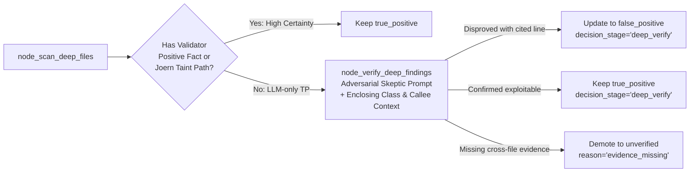
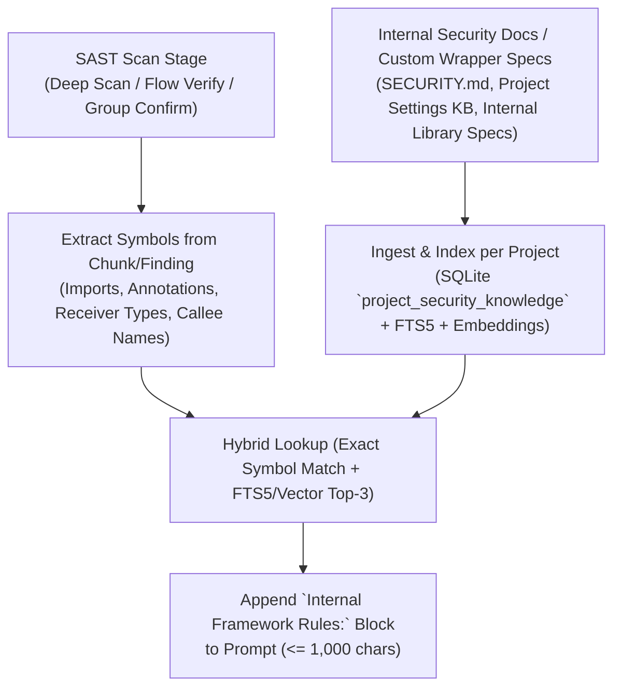

# Improving SAST Findings in Secure Build: Architecture & Implementation Roadmap

> **Historical note:** this roadmap predates the removal of the Joern/code-property-graph stage. References to Joern below describe a stage that no longer exists.

> **Target Codebase:** `backend/sast_engine/` & `backend/app/services/`  
> **Goal:** Increase true-positive recall, eliminate false-positive noise, preserve cross-file context, and teach the scanner custom enterprise frameworks—without breaking the `$2` LLM spend budget (`LLM_COST_CUTOFF_USD`) or the accuracy release gate (`scripts/accuracy/gate.py`).

---

## Executive Summary: Where Secure Build Stands Today vs. Target Upgrades

Secure Build is already much further along than a naive regex/AST scanner. Across `EPIC-00` through `EPIC-03`, the engine already implements:
- A 9-stage parallel LangGraph pipeline (`backend/sast_engine/sast_scan_agent.py`)
- Tree-sitter AST parsing (`ast_struct.py`, `pipeline/occurrence_facts.py`)
- Inter-file call graphs (`pipeline/call_graph.py`, `pipeline/call_graph_python.py`) + optional Joern CPG dataflow (`pipeline/joern_runner.py`, `joern/flows.sc`)
- Deterministic per-occurrence validators (`pipeline/validators/`) for SQL binding (`sql_semantics.py`) and log/output sinks (`output_sinks.py`, `exception_provenance.py`, `logging_config.py`, `angular_render.py`)
- Per-member grouped LLM confirmation (`confirm_finding_group_batch` in `pipeline/llm_file_scan.py`) and deterministic explanation checks (`pipeline/explanation_check.py`)

However, **specific structural blind spots** in each of the 4 accuracy areas still cause missed vulnerabilities (false negatives) or noisy/unverified alerts (false positives).

| # | Pillar | What Secure Build Already Has | Core Gap Today | High-Leverage Upgrade |
| :--- | :--- | :--- | :--- | :--- |
| **1** | **Inter-Procedural Taint Analysis** | Java/Python call graphs (`call_graph.py`), optional Joern CPG (`flows.sc`), `SqlSummaries` (`sql_semantics.py`), `reachability.py` | Tree-sitter call graph tracks method-to-method calls, **not** argument-to-parameter taint (except SQL); no TypeScript call graph; DTO field taint (`dto.getFoo()`) is lost across hops | Build a general **Argument-Index `TaintSummary`** pass across all sink kinds, add **DTO/Carrier field taint tracking**, and add `call_graph_typescript.py` |
| **2** | **LLM-Driven False Positive Filtering** | `confirm_finding_group_batch`, deterministic `validators/`, `explanation_check.py`, `fp_visibility.py` | Deep-scan (`node_scan_deep_files`) TPs are **single-pass** (never challenged); CWE-22/78/611/918 lack deterministic validators; past human `FindingReview` overrides are ignored on rescan | Add a **Deep-Scan TP Challenger node**, build deterministic validators for Path Traversal / XXE / SSRF, and inject prior `FindingReview` decisions |
| **3** | **AST-Aware Semantic Chunking** | `chunk_file()` (350-line window + regex probe) and `skeleton_for_chunk()` in `llm_file_scan.py` | `chunk_file()` still cuts on line counts + regex (`_BOUNDARY_PATTERNS`), splitting large methods; deep scan & group confirm cannot see **cross-file helper/sanitizer bodies** or **`SecurityConfig`** rules | Replace line-window chunking with **Tree-sitter AST method/class chunking** + automatic **Neighborhood Context Injection** (callees, constants, global auth config) |
| **4** | **RAG for Custom Internal Frameworks** | `dep_classify.py` (LLM dependency labels) + `derive_rules.py` (Pass A call-graph sink wrappers + Pass B LLM sink rules) | Only derives custom **sinks**—never discovers custom **sanitizers**, **auth annotations** (`@CompanyAuth`), or **security interceptors/filters** | Build a **2-Layer Custom Control System**: (1) AST auto-extraction of repo sanitizers/auth annotations (`custom_controls.py`) + (2) SQLite FTS5/Vector RAG over internal security docs |

---

## 1. Inter-Procedural Taint Analysis

### Current State in Code
- **`backend/sast_engine/pipeline/call_graph.py` & `call_graph_python.py`:** Builds a method-level graph (`entry -> hop -> sink`) and passes slices to `pipeline/flow_verify.py`.
- **`backend/sast_engine/pipeline/flow_verify.py` (lines 3–5):** Explicitly notes: *"The graph has no argument-level taint, so the slice is the only precision mechanism: every hop's complete method body is sent."*
- **`backend/sast_engine/pipeline/sql_semantics.py` (`SqlSummaries`):** Computes demand-driven method summaries (up to depth 6), but **only for SQL execution (`CWE-89`)**.
- **`backend/sast_engine/pipeline/joern_runner.py` & `joern/flows.sc`:** Runs CPG taint tracking when Joern is installed, but Joern is optional and heavy (`-Xmx4g`, 900s timeout), and its `sanitizers` in `joern/taint_spec.json` only annotate (`Flow.sanitizers`) rather than deterministically proving safety.

### Concrete Upgrades to Implement

#### 1.1 Generalize `SqlSummaries` into an Argument-Index `TaintSummary` Engine (`pipeline/taint_summaries.py`)
Right now, if `Controller.getUser(String id)` calls `Service.process(id, "constant_cmd")`, and `Service.process(String userId, String cmd)` passes `cmd` (parameter index `1`, which is a constant!) to `Runtime.getRuntime().exec(cmd)`, the Tree-sitter call graph still flags a flow from `Controller.getUser` to `exec` because it only checks that `getUser` calls `process` and `process` contains a `command` sink.

- **How to build it:**
  1. In `pipeline/call_graph.py`, record for every method node:
     - `param_to_sink_args: Dict[int, List[Tuple[str, int]]]` — which method parameter indices (`0..k`) flow into which sink kind (`sql`, `command`, `files`, `ssrf`, `xss`, `ldap`, `deser`, `redirect`) without passing through a type-narrowing conversion (`Integer.parseInt`, `Long.valueOf`, `UUID.fromString`, `Boolean.parseBoolean`).
     - `param_to_callee_args: Dict[int, List[Tuple[CalleeRef, int]]]` — which parameter index is passed into which argument index of a downstream call.
     - `returns_tainted_from_param: Set[int]` — whether the method's `return` expression propagates parameter `i`.
  2. During `discover_flows` in `call_graph.py`, propagate taint **by argument position** across the call chain (`entry_param_idx -> hop1_arg_idx -> hop2_arg_idx -> sink_arg_idx`).
  3. **Result:** Any call edge where the sink argument receives a literal, constant, enum, or an untainted parameter is pruned **deterministically before `flow_verify.py` makes an LLM call**.

#### 1.2 Track DTO / Carrier-Object Field Taint Across Methods
In Spring Boot, JAX-RS, and NestJS, untrusted input is almost always deserialized into a DTO (`@RequestBody CreateOrderRequest req`) and read 2–3 hops later via `req.getFileName()` or `req.fileName`.
- **How to build it:**
  1. In `pipeline/entry_points.py` and `call_graph.py`, collect every parameter type annotated with `@RequestBody`, `@ModelAttribute`, `@BeanParam`, or JAX-RS/Spring controller body bindings as a **`TaintedCarrierType`**.
  2. Map each getter/field on a `TaintedCarrierType` using `ast_struct.py`:
     - If the getter's return type in `JavaMethod.return_type` is primitive/numeric/boolean/enum (`int`, `long`, `Long`, `UUID`, `BigDecimal`, `boolean`, or an `enum`), mark that getter as `CONSTRAINED`.
     - If the field has Jakarta Bean Validation (`@Pattern(regexp=...)` with a strict allowlist, `@Digits`, `@Positive`), record the constraint on the carrier field.
     - Otherwise, mark `carrier.get<Field>()` as a `tainted_dto_source` when `carrier` is passed to service/DAO methods.
  3. Feed this into `occurrence_facts.py` so `facts["args"]` classifies `req.getUserQuery()` as `tainted_dto_field` instead of generic `call_result`.

#### 1.3 Add `pipeline/call_graph_typescript.py` for Angular & Node/NestJS/Express
`ast_struct.py` already initializes `_ts_parser()` (`tree_sitter_typescript`).
- Build `call_graph_typescript.py` implementing `GraphAdapter` (`call_graph_common.py`) to trace:
  - **Angular:** `ActivatedRoute.queryParams` / `HttpClient.get()` -> Component property / method -> template `[innerHTML]` or `DomSanitizer.bypassSecurityTrust*` or `ElementRef.nativeElement`.
  - **Node/Express/NestJS:** `@Body()` / `@Query()` / `req.body` / `req.query` -> Service method -> Prisma/Sequelize/TypeORM raw query (`$queryRawUnsafe`), `child_process.exec`, `fs.readFile`, or `res.send`.

---

## 2. LLM-Driven False Positive Filtering

### Current State in Code
- **`node_confirm_triage_groups` (`pipeline/llm_file_scan.py`):** Packs regex triage groups into batches (`GROUP_CONFIRM_BATCH_MAX_SHOWN = 24`), deduplicates identical code variants (`_variant_of`), sends `occurrence_facts` + validator notes + reachability evidence, and updates verdicts via `verdict_updates_writer`.
- **`pipeline/validators/`:** Runs deterministic AST validators (`sql_binding`, `wrapper_call_identity`, `log_call_boundary`, `log_value_domain`, `log_exception_provenance`, `log_layout`, `servlet_output_sink`, `angular_render_context`, `stub_method`, `declaration_not_call`) with strict precedence (`negative_proof` > `positive_fact` > `evidence_gap`).
- **`pipeline/explanation_check.py`:** Runs 5 post-LLM consistency checks and retries once with a `Deterministic facts:` block if the model contradicts itself.

### Concrete Upgrades to Implement

#### 2.1 Add a Dedicated "Adversarial Skeptic" Verification Pass for Deep-Scan TPs (`node_verify_deep_findings`)
Today, regex findings get a dedicated verification pass (`node_confirm_triage_groups`), and call-graph flows get `node_verify_flow_slices`. **Deep-scan findings (`node_scan_deep_files`) do not**: a single LLM call scans a 350-line chunk for 50+ vulnerability classes at once and emits `true_positive` rows directly. When a model scans a whole file for everything at once, its precision on subtle controls (e.g., a path check 30 lines above, a class-level `@PreAuthorize`, or a constant-only map lookup) is significantly lower than when asked to validate a single concrete hypothesis.



- **How to build it in `sast_scan_agent.py` & `llm_file_scan.py`:**
  1. Filter deep-scan `true_positive` findings to those that **lack** a deterministic `positive_fact` in `finding["facts"]["validators"]` and **lack** `reachability.status == "path"`. (Typically only 10–35 findings per scan, costing <$0.05 in tokens).
  2. Batch them (`5–8` findings per call) with a dedicated **Skeptic Validator Prompt**:
     - Provide: (a) the full enclosing method, (b) class-level annotations & fields, (c) resolved callee bodies from the call graph, and (d) the project's global security config summary (`SecurityConfig` / `web.xml`).
     - Ask the LLM to answer a structured checklist before emitting `verdict`:
       1. `attacker_controllable_source`: Which exact parameter/input does the attacker control, or is the value derived from server config/constants/DB primary keys?
       2. `guard_or_sanitizer_on_path`: Is there an allowlist, type conversion, path canonicalization (`startsWith`), or framework guard between source and sink?
       3. `verdict`: `true_positive` | `false_positive` | `unverified`.
  3. Record the decision in `finding_decisions` under stage `deep_verify`.

#### 2.2 Expand Deterministic AST Validators (`pipeline/validators/`) to the Next 4 Noisiest CWEs
`EPIC-02` (SQLi) and `EPIC-03` (Logs/XSS) proved that deterministic validators eliminate 60–80% of false positives **before** the LLM is even asked. Add three new validators registered in `pipeline/validators/__init__.py`:

1. **`validators/path_traversal.py` (`CWE-22`, `java-path-file-constructor`, `java-file-from-request-getter`, `spring-requestparam-to-file`):**
   - **`negative_proof` (`path_arg_constant_or_numeric`):** All arguments to `new File(...)` / `Paths.get(...)` are `string_literal`, `constant`, `numeric`, `enum`, or `UUID` in `occurrence_facts`.
   - **`negative_proof` (`path_canonicalized_and_prefixed`):** Within the enclosing method, the `Path`/`File` variable calls `.normalize()` / `.getCanonicalPath()` / `.toRealPath()` **and** is guarded by an `if (!normalized.startsWith(baseDir))` or `FilenameUtils.getName(...)` before reaching a file stream sink.
   - **`positive_fact` (`path_unvalidated_request_param`):** A request parameter or DTO string getter flows directly into `new FileInputStream(...)` / `Files.readAllBytes(...)` with no normalization or `getName()` call in the method.
2. **`validators/xxe_hardening.py` (`CWE-611`, `java-xxe-*`):**
   - Use Tree-sitter on the enclosing method (and any helper factory method it calls via `call_graph`) to inspect `setFeature` / `setProperty` calls on the parser factory variable:
     - If `disallow-doctype-decl = true` or (`external-general-entities = false` **and** `external-parameter-entities = false`) or `FEATURE_SECURE_PROCESSING` + `ACCESS_EXTERNAL_DTD = ""` is set on that variable on every branch before `.newDocumentBuilder()` / `.parse()`, emit **`negative_proof` (`xxe_factory_hardened`)**.
3. **`validators/ssrf_url_domain.py` (`CWE-918`):**
   - Inspect the URL argument passed to `RestTemplate`, `WebClient`, `HttpClient`, `URL.openConnection()`, or `fetch()`:
     - If the scheme + host prefix is a compile-time `string_literal` or `static final` constant (`https://internal.api.company.com/` + path segment where the path segment is numeric/UUID or URL-encoded without `?`/`#`/`@`/`..`), emit **`negative_proof` (`ssrf_fixed_host_constrained_path`)**.

#### 2.3 Reuse Prior Human `FindingReview` Decisions Across Rescans
In `backend/app/services/feedback.py`, human reviewers mark findings as `false_positive` or `resolved` with a `reviewer_note`, keyed by `Finding.occurrence_id` and group fingerprint.
- **Upgrade:** In `agent_bridge.run_real_scan`, query `FindingReview` for the project's prior overridden false positives. When an occurrence with the **exact same `occurrence_id`** (which hashes `project | file | rule | cwe | normalized sink | enclosing method signature | ordinal`) and **unchanged `semantic_signature(facts)`** recurs, attach the reviewer's prior override reason to `FindingDecision` and skip redundant LLM re-confirmation unless `bypass_llm_cache` is set.

---

## 3. AST-Aware Semantic Chunking & Neighborhood Context Engineering

### Current State in Code
- **`backend/sast_engine/pipeline/llm_file_scan.py` (`chunk_file`, lines 403–432):**
  - Splits files larger than `SINGLE_CALL_CHAR_BUDGET` (`28,000` chars) by fixed line count (`CHUNK_LINE_BUDGET = 350`, `OVERLAP_LINES = 40`), probing forward up to 60 lines with a regex (`_BOUNDARY_PATTERNS`).
  - Because `_BOUNDARY_PATTERNS["java"]` matches `^\s*(public|private|protected|static|final|abstract|@\w+)\b`, it snaps chunk cuts onto **private fields**, **`@Override` annotations**, or **mid-class declarations**, and still slices >400-line methods in half.
  - `skeleton_for_chunk` (lines 467–492) provides a 1-line-per-hit summary of imports, declarations, and regex taint lines from the *same* file, but provides **zero cross-file neighborhood context**.
- **`confirm_finding_group_batch` (`llm_file_scan.py`):**
  - Sends only a `±10` line window (`TRIAGE_CONTEXT_LINES = 10`) around each regex hit. If the enclosing method is 60 lines long and validates the variable at the top of the method (25 lines above the sink), the LLM **cannot see the validation**!

### Concrete Upgrades to Implement

#### 3.1 Replace `chunk_file` Line-Window Splitting with Tree-Sitter AST Structural Chunking (`pipeline/ast_chunker.py`)
Use `ast_struct.parser_for_lang(lang)` (`java`, `typescript`, `python`) to chunk oversized files along **true AST declaration boundaries**:

1. **Class Header Pinning (`class_context_header`):**
   - For every chunk of a class/module, automatically prepend a compact structural header (preserving exact 1-based line numbers):
     - Package + security-relevant imports
     - Class-level annotations (`@RestController`, `@RequestMapping("/api/v1/admin")`, `@PreAuthorize("hasRole('ADMIN')")`, `@Component`)
     - Class field declarations (`private final JdbcTemplate jdbc;`, `private static final String BASE_DIR = "/var/app/uploads";`)
2. **Whole-Method Packing:**
   - Walk `class_body` / module children (`method_declaration`, `constructor_declaration`, `function_declaration`, `arrow_function`).
   - Include each method's leading annotations/decorators (`@PostMapping`, `@PreAuthorize`, `@Transactional`) and Javadoc security notes inside its span `(decl_start_line, decl_end_line)`.
   - Pack complete methods greedily into chunks up to `SINGLE_CALL_CHAR_BUDGET` (`28,000` chars).
   - **Bonus — Risk-Prioritized Method Packing:** In a 3,000-line legacy Java class (`RequestsMgr.java`), methods containing entry points or typed sinks (`call_graph`) are packed into the first chunks, while pure getter/setter/boilerplate methods (`equals`, `hashCode`, `toString`, simple getters) are omitted or summarized in the file skeleton!
   - Fall back to the existing `chunk_file` line-window splitter **only** when a single giant method exceeds `SINGLE_CALL_CHAR_BUDGET` or for languages without a Tree-sitter grammar.

#### 3.2 "Neighborhood" Context Engineering: Callee Definitions, Constants & Global Security Config
When the LLM analyzes a method in `node_scan_deep_files` or confirms a group in `node_confirm_triage_groups`, inject a deterministic **`Neighborhood context:`** block assembled from the AST index and `call_graph`:

```
=== Neighborhood Context (Resolved from Repository AST) ===
[Enclosing Method L112-L168]: public ResponseEntity<Report> downloadReport(@RequestParam String fileId) { ...full method... }
[Callee 1 — com.acme.security.PathValidator#assertSafeFileName(String) (src/main/java/.../PathValidator.java:18-29)]:
  18: public static String assertSafeFileName(String input) {
  19:     if (input == null || !input.matches("^[a-zA-Z0-9._-]+$")) throw new SecurityException("Invalid filename");
  20:     return FilenameUtils.getName(input);
  21: }
[Resolved Constant — com.acme.config.SqlConstants.FIND_BY_STATUS (src/main/java/.../SqlConstants.java:12)]:
  "SELECT id, status FROM orders WHERE tenant_id = ? AND status = ?"
[Global Route Auth — SecurityConfig.java:44-52]:
  .requestMatchers("/api/admin/**").hasRole("ADMIN")
  .requestMatchers("/api/public/**").permitAll()
```

- **Where to wire this in Secure Build:**
  1. **In `confirm_finding_group` / `confirm_finding_group_batch` (`llm_file_scan.py`):**
     - Instead of slicing `line - 10` to `line + 10` blindly, read `finding["facts"]["method"]` (`start_line`, `end_line` from `occurrence_facts.py`). If the enclosing method is `<= 45` lines, include the **entire enclosing method**; if larger, include the method signature + parameter annotations + variable declaration/assignment lines for the sink's arguments + `±10` lines around the sink.
  2. **Callee Neighborhood Resolver (`pipeline/neighborhood.py`):**
     - Given a method or finding's `facts`, inspect all calls inside the enclosing method that pass or return the sink's variables.
     - Look up each callee via `call_graph.resolve_targets(owner, name, arity)`.
     - If the target is a project method (e.g., a custom validator, sanitizer, query builder, or wrapper) under `40` lines, attach its numbered body (up to `3` callees, capped at `2,000` chars total).
  3. **Global Auth/Filter Summary for Absence Checks:**
     - During `node_map_modules_and_risk` / `node_build_call_graph`, extract a compact summary (`<= 800` chars) of `SecurityFilterChain` / `WebSecurityConfigurerAdapter` (`*SecurityConfig*.java`), `web.xml` `<security-constraint>`, and Angular route `canActivate` guards.
     - Attach this summary when deep-scanning controller/resource files so the LLM knows which URL patterns are already protected globally before reporting "Missing `@PreAuthorize`" or "CSRF disabled".

---

## 4. RAG & Auto-Discovery for Custom Internal Frameworks

### Current State in Code
- **`pipeline/dep_classify.py`:** Maps unrecognized dependencies in `pom.xml` / `package.json` / `requirements.txt` onto known `stack_signatures.SIGNATURES` labels.
- **`pipeline/derive_rules.py`:**
  - **Pass A (`wrappers_from_graph`):** Automatically discovers project methods that wrap a dangerous sink (`runtime-sink-sql-*`, `runtime-sink-command-*`, etc.).
  - **Pass B (`llm_derive_rules`):** Asks the LLM for up to 30 extra source/sink regex patterns.
- **The Blind Spot:** `derive_rules.py` only discovers **custom sinks and sources** (things that *create* vulnerabilities). It has **no mechanism to discover or retrieve custom security controls** (things that *prevent* vulnerabilities):
  - Custom internal sanitizers (`CompanyStringUtils.sanitizeSqlIdentifier()`, `PathGuard.ensureUnderRoot()`)
  - Custom auth annotations/decorators (`@CompanyAuth`, `@InternalEndpoint`, `@TenantScoped`)
  - Internal framework wrappers that enforce parameterization or escaping (`SafeDao.query()`, `SafeHtmlRenderer.render()`)

### Concrete Upgrades to Implement

#### 4.1 Layer 1: Zero-Config AST Extraction of Custom Repo Controls (`pipeline/custom_controls.py`)
Before running `node_scan_deep_files` or `node_confirm_triage_groups`, run a fast, deterministic AST pass (`node_discover_custom_controls` alongside `node_derive_runtime_rules`) that mines the repository itself for internal security controls:

1. **Custom Security Annotations & Interceptors:**
   - Find all `@interface` declarations in the repo (or TS decorators / Python decorators) that are referenced inside a `HandlerInterceptor`, `OncePerRequestFilter`, `MethodInterceptor`, `@Around` AOP advice, Spring `SecurityFilterChain`, or Angular `CanActivate` guard.
   - Example: If `AuthAspect.java` has `@Around("@annotation(com.company.RequirePermission)")`, automatically register `@RequirePermission` as an **Auth Guard Annotation** equivalent to `@PreAuthorize`!
2. **Custom Sanitizer & Validator Methods:**
   - Scan methods in classes matching `*(Validator|Sanitizer|Escape|Encoder|SecurityUtil|PathUtil|Guard)*` (or any method called inside an `if (...) throw new *Exception`) and classify what they enforce using Tree-sitter:
     - **Allowlist / Regex Guard:** Method checks `Pattern.matches(...)` or `.matches("^[a-zA-Z0-9_-]+$")` or `Set.contains(...)` and throws/returns boolean -> register as `custom_allowlist_validator`.
     - **HTML/Log/SQL Escaper:** Method wraps `HtmlUtils.htmlEscape`, `ESAPI.encoder()`, `StringEscapeUtils`, or `.replaceAll("[\\r\\n]", "_")` -> register as `custom_sanitizer(kinds=["xss" | "log" | ...])`.
     - **Path Confiner:** Method calls `.normalize()` / `.getCanonicalPath()` + `.startsWith(...)` -> register as `custom_sanitizer(kinds=["files"])`.
3. **Wire into Both Deterministic & LLM Stages:**
   - Dynamically append discovered `custom_sanitizer` methods to Joern's runtime `taint_spec.json` (`sanitizers` list) and to `validators/`.
   - Inject discovered custom auth annotations and sanitizers into the system prompt of `node_scan_deep_files`, `node_verify_flow_slices`, and `node_confirm_triage_groups` so the LLM never flags a controller protected by `@RequirePermission` as "missing auth" or a variable cleaned by `CompanySanitizer.cleanLog(x)` as log injection.

#### 4.2 Layer 2: Per-Project Internal Framework RAG (`app/services/security_knowledge.py`)
For enterprise conventions that live in internal documentation, architecture guidelines, or external internal libraries (whose source code is in a JAR/package rather than the scanned repo):



- **How to build it cleanly in Secure Build (SQLite-native, zero external vector DB required):**
  1. **Schema (`backend/app/models.py` & `db._run_light_migrations`):**
     - Add table `project_security_knowledge`:
       - `id`, `project_id`, `kind` (`sanitizer` | `auth_wrapper` | `safe_sink` | `guideline`), `symbol_pattern` (e.g., `com.company.auth.CompanyAuthWrapper`, `@RequireScope`), `applies_to_cwes` (JSON list, e.g. `["CWE-89", "CWE-862"]`), `summary` (<= 500 chars), `embedding_json` (optional float array).
     - Auto-ingest any `SECURITY.md`, `.secure-build/controls.yaml`, or `docs/security/**/*.md` found in the repository during `node_scan_directory`, plus allow admins/users to manage entries in `/projects/[id]/settings`.
  2. **Deterministic Symbol-First + Semantic Retrieval (`pipeline/rag_retriever.py`):**
     - When preparing a prompt for a file chunk (`scan_file`) or a finding group (`confirm_finding_group_batch`), extract the set of **imported packages, class annotations, receiver types (`facts["call"]["receiver_type"]`), and callee names**.
     - Query `project_security_knowledge` in two passes:
       1. **Exact Symbol / Prefix Match (0ms, 100% precision):** Match `symbol_pattern` against imports, annotations, and resolved receiver types in the chunk.
       2. **BM25 / Embedding Fallback:** Match the finding's `cwe` + `rule_id` + `sink` against `applies_to_cwes` and `summary`.
  3. **Cache-Safe Prompt Injection:**
     - Keep `build_system_prompt()` **byte-identical** so Bedrock prompt caching (`should_cache_system_prompt`, 0.1× read cost) continues to hit on every call!
     - Inject the retrieved internal framework rules at the top of the **user prompt** right above the code chunk (or alongside `Deterministic facts:` in `confirm_finding_group_batch`).

---

## 5. Prioritized Implementation Roadmap & Accuracy Gate Verification

Every change below should be gated with `python scripts/accuracy/gate.py --baseline backend/tests/accuracy_corpus/accuracy_baseline.json` so no existing true positive regresses (`Gate 1` & `Gate 5`).

| Phase | Deliverable | Key Files to Touch in `secure-build` | Expected Impact on Findings |
| :--- | :--- | :--- | :--- |
| **Phase 1 (Quick Wins — Context & Chunking)** | **1.** Full enclosing method window + callee neighborhood in `confirm_finding_group_batch`<br>**2.** Tree-sitter AST method/class chunker (`ast_chunker.py`) + class header pinning<br>**3.** Global `SecurityConfig` / `web.xml` summary injected into controller deep scans | `backend/sast_engine/pipeline/llm_file_scan.py`<br>`backend/sast_engine/pipeline/neighborhood.py` *(new)*<br>`backend/sast_engine/ast_struct.py` | Eliminates false positives caused by validation/guards >10 lines away from a regex hit; eliminates false "Missing Auth" findings when routes are secured in `SecurityConfig` |
| **Phase 2 (Taint & Deterministic Validators)** | **1.** Generalize `SqlSummaries` into multi-sink argument-index `TaintSummary`<br>**2.** DTO/Carrier field taint tracking (`@RequestBody` getters)<br>**3.** Add `path_traversal.py`, `xxe_hardening.py`, and `ssrf_url_domain.py` validators | `backend/sast_engine/pipeline/call_graph.py`<br>`backend/sast_engine/pipeline/occurrence_facts.py`<br>`backend/sast_engine/pipeline/validators/` | Prunes false call-graph flows before LLM calls; auto-dismisses safe `File`/`XXE`/`SSRF` idioms with deterministic `negative_proof` (0 LLM tokens) |
| **Phase 3 (Adversarial TP Filter & Custom Controls RAG)** | **1.** `node_verify_deep_findings` (Adversarial Skeptic pass on uncorroborated deep-scan TPs)<br>**2.** `custom_controls.py` (auto-extract custom `@Auth` annotations & sanitizers from repo AST)<br>**3.** Per-project `project_security_knowledge` RAG lookup | `backend/sast_engine/sast_scan_agent.py`<br>`backend/sast_engine/pipeline/custom_controls.py` *(new)*<br>`backend/app/models.py` | Cuts deep-scan hallucinated TPs by 50–70% for <$0.05/scan; teaches the scanner internal company wrappers & auth annotations automatically |
