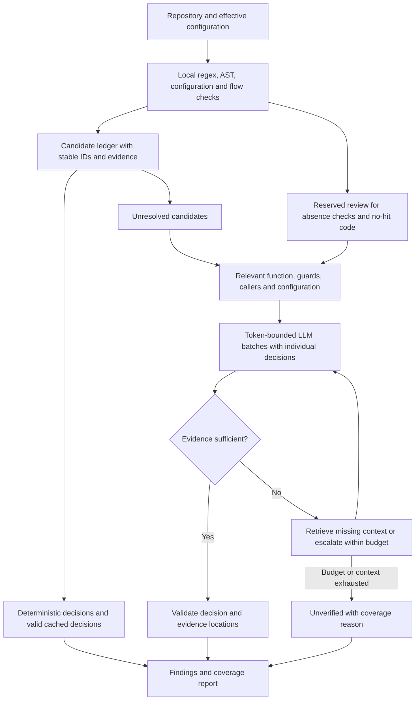

# SAST regex + LLM efficiency and finding-quality plan

Date: 2026-10-13. Status: proposed; no scanner implementation changes.

The objective is to reduce tokens per scan while preserving or improving independently measured vulnerability recall and precision. Keep regex as inexpensive candidate discovery, use structural evidence to explain candidates, and spend LLM tokens on decisions that remain uncertain. A pattern match is not proof of exploitability; a model verdict is not ground truth.

## Current behavior and measured baseline

This assessment follows the current working tree, which contains existing uncommitted changes. Some README and CLAUDE.md descriptions are older than the code.

- Discovery, dependency/framework identification, and risk mapping run locally.
- API defaults select **CRITICAL-only** deep scanning, capped at 100 files; HIGH/MEDIUM/LOW and overflow files use **per-file `llm_triage`**. A regex miss makes no triage LLM call. See `backend/app/services/agent_bridge.py:152` and `backend/sast_engine/sast_scan_agent.py:1301`.
- Deep scanning sends complete files or chunks, applicable catalog guidance, and a skeleton for multi-chunk files. The 24,000-character threshold switches to 450-line chunks with overlap; it is not a complete-request token limit. See `pipeline/llm_file_scan.py:325`, `:596`, and `:1152`.
- Per-file triage sends every regex hit with a separate ±10-line context window and requests the full finding schema. See `pipeline/llm_file_scan.py:1371`.
- The alternate `regex_only` path can group candidates and confirm five groups per call. API scans enable confirmation without a group-count cap, but the default per-file mode bypasses this regex grouping stage. Joern findings have their own grouped confirmation. See `sast_scan_agent.py:2117`, `:2200`, and `:2251`.
- Optional graph analysis verifies selected flows before deep scans and triage. The default flow cap is 30. Runtime rule derivation can also call the LLM.

Latest successful local SAST scan inspected read-only: `d2781de4-a54e-4ea5-894e-f420c6e3e552`, October 13, 2026, using the Haiku preset. Logs show 131 discovered files, 9 deep files, and 122 triage files. Of the triage files, 115 had zero regex hits: **94.3% avoided a triage LLM call**. This is a useful cost filter, not an accuracy score.

| Stage | Recorded calls | Recorded input + output tokens | Share |
|---|---:|---:|---:|
| Deep scans | 9 | 58,680 | 58.4% |
| Flow verification | 12 | 21,280 | 21.2% |
| Per-file regex triage | 7 | 14,034 | 14.0% |
| Runtime rule derivation | 1 | 5,424 | 5.4% |
| Group confirmation | 1 | 1,040 | 1.0% |
| Total | 30 | 100,458 | 100% |

Total recorded input: 81,643; output: 18,815. Recorded estimated cost: $0.175718. These are application usage records, not independently reconciled provider billing. Empty-response retry accounting currently has a gap. Six completed SAST scans in this database share the same repository commit, but engine revisions and effective configurations were not fully snapshotted, so they are not a controlled comparison. There are no SAST human triage-event records establishing ground truth.

Implication: eliminating every triage token would save only about 14% on this particular run. Deep and flow analysis together account for about 80%; they deserve most optimization attention. Larger repositories may have a different distribution.

## Correctness prerequisites

Address these before enabling more aggressive filtering or group reuse:

| Priority | Observed code behavior | Required change |
|---|---|---|
| P0 | Per-file triage returns only model-produced findings; omitted candidates, exceptions, or failed parsing can leave no finding row (`llm_file_scan.py:1460`–`:1506`). | Persist candidates before review. Reconcile every requested candidate ID to a valid decision or explicit `unverified` status with a reason. |
| P0 | Unknown/missing verdict strings become `false_positive` (`llm_file_scan.py:705`). Group parsing accepts an object without a real reason (`:1802`). | Strict decision schema. Invalid, missing, ambiguous, or incomplete decisions must never mean safe. |
| P0 | Regex-only finding dictionaries omit `file_path` (`:1537`); grouping reads it from the child dictionary (`:2174`). The database writer receives the path separately. | Give every candidate an immutable identity and path. Add an integration test from real regex-hit conversion through confirmation and database update. Existing synthetic group fixtures supply the missing path themselves. |
| P0 | Groups use rule + matched text, or rule alone; one representative's verdict is copied to all members (`:1745`, `:2157`, `:2188`). | Separate UI grouping from analysis equivalence. Batch independent candidates together, but preserve individual decisions unless all relevant code and security context are equivalent. |
| P0 | Logging-call presence triggers unconditional suppression, even though logging weaknesses are in the catalog (`:936`). | Replace blanket suppression with vulnerability-specific evidence checks; test unsafe log input and secret exposure alongside safe logging. |
| P0 | Partial JSON recovery can appear complete; flow parse failures can still increase `flows_verified` (`llm_client.py:595`, `flow_verify.py:211`, `:261`, `:269`). | Preserve completeness and stop reason; distinguish attempted, complete, partial, failed, and deferred analysis. |
| P1 | Multiline regex uses one `.search()` per file and bypasses comment masking (`regex_scan.py:376`). | Enumerate distinct match spans with explicit limits and overflow reporting; use language-aware comment/string handling appropriate to the rule. Secret rules may intentionally inspect strings or comments. |

These are code-path observations. Their aggregate effect on precision and recall has not been measured on labeled examples.

## Proposed pipeline



### 1. Make candidate accounting and evidence reliable

Introduce a candidate ledger shared by regex, Joern, flow, and LLM discovery. Store occurrence ID, repository revision, path, span, function, detector/rule version, weakness family, relevant source/sink/guard/configuration evidence, and review state. Do not delete candidates because a model did not return them.

Keep the public verdict vocabulary initially: `true_positive`, `false_positive`, `unverified`. Store separate review reasons such as `missing_context`, `invalid_response`, `budget_deferred`, or `detector_only`. Record suppressed findings with a reason rather than treating suppression as evidence of safety. A transport failure is not a security decision.

Validate that evidence IDs resolve to the supplied code and that line references are real. Injection findings need evidence of the source-to-sink relationship and applicable defenses; configuration, cryptography, and secret findings need their own rule-specific proof requirements. Do not require a fabricated taint source for every CWE. A model's confidence score alone must not determine publication or suppression. Treat repository comments and strings as review data, never as instructions to the reviewing model; include misleading instructions in evaluation fixtures.

### 2. Improve local detection and supply the right context

Run inexpensive detectors across all eligible files, including deep-scan files, and record coverage independently of LLM availability. In the current API default mode, disabling the LLM can also skip regex triage (`sast_scan_agent.py:1948`); decouple these operations.

Reuse the existing tree-sitter/call-graph and Joern infrastructure. Apply local structural checks to noisy rule families first: SQL construction, path handling, command execution, output encoding, logging, and framework configuration. Track sources, sinks, guards, sanitizers, and their scope. A call graph alone is not proof of taint flow. Source/sink/sanitizer modeling is also the basis of [Semgrep's documented taint analysis](https://docs.semgrep.dev/writing-rules/data-flow/taint-mode/overview); adopting another engine is not required for the initial work.

Replace repeated ±10-line windows with one shared, numbered context block per function or overlapping interval. Include necessary assignments, branch conditions, imports, call arguments, and relevant caller/callee or application security configuration. Expand on demand if a source, sanitizer, authorization policy, or deployment setting is unresolved. Missing nearby evidence must not imply either vulnerability or safety.

Absence checks need an explicit scope: route-level settings plus applicable middleware/global configuration. Keep a budget for these checks and a stratified sample of no-hit code. A regex-only gate cannot recover vulnerabilities that its catalog never nominates.

### 3. Batch safely and reduce repeated input/output

Start with independent candidates sharing a function or flow, then pack compatible contexts to a measured input-token limit with output headroom. Use the existing five-group size only as an initial maximum, not as the budget. Include every distinct occurrence's relevant context; return one decision per candidate ID. Do not turn on today's representative-broadcast mode as a quick saving.

Deduplicate analysis across regex, Joern, flow, and deep passes before inference using equivalent weakness + sink/span + source/path/security context. Merge supporting evidence while retaining each origin. Different paths to the same sink can have different sanitizers or access controls, so a sink-only key is insufficient. Once an issue is reviewed, deep review can concentrate on uncovered behavior while retaining its broader discovery role.

Use a compact common envelope, for example:

```json
{"decisions":[{"id":"c17","verdict":"unverified","evidence_ids":["e4"],"reason":"Caller input origin is unavailable","needed_context":["caller_of_f3"]}]}
```

Resolve file paths, snippets, catalog titles, CWE/OWASP labels, and known metadata locally. Require a brief evidence-linked explanation. Use rule remediation templates for known findings; generate a custom fix only for a confirmed novel issue or on demand. Keep a separate bounded schema for newly discovered findings. Compact JSON formatting and smaller applicable rule guidance reduce input; shorter decisions reduce output.

Unify the schema with transport behavior: current Bedrock JSON mode pre-fills `{`, while some callers request arrays (`llm_client.py:294`). Use supported structured-output mechanisms where available and validate on every provider. Retry only missing/invalid decisions once, with their necessary context; preserve unresolved candidates after that. Do not blindly lower `max_tokens=4096`: it is a ceiling, not automatic consumption, and truncation can lose findings.

### 4. Replace file-count spending with coverage and token budgets

Prioritize by observed security behavior, exposure, uncertainty, change impact, and estimated context cost. Path risk remains one signal, not the sole priority. Keep module/language coverage and reserved absence/no-hit review so inexpensive common patterns do not crowd out rare critical behavior.

Count the complete prompt, including system guidance, code, schema, and output reserve. Current file chunks and per-hop flow size checks do not enforce this. Reserve estimated spend/tokens atomically before dispatch; reconcile actual usage after each response. Apply shared scan limits and stage allowances, including retries and escalation. Stop or defer explicitly when exhausted. Persist accounting for failed/cancelled scans too, and track unreconciled requests when transport failures leave provider usage unknown. Reservations govern admitted work; estimates alone cannot guarantee exact provider billing.

The existing $2 cutoff switches later calls to Ollama based on completed spend. It does not cap total tokens and concurrent calls can exceed the threshold. Evaluate primary and fallback models on the same held-out fixtures; record which model made each decision. A zero API-price fallback still consumes tokens and compute and may have different finding quality.

Use a small/default model for evidence-complete routine decisions and escalate only unresolved, high-impact cases. Escalation should be triggered by missing evidence, contradictions, or validated failure classes, not a confidence number alone. Start with current models to isolate pipeline gains before changing model selection.

### 5. Cache validated work and support incremental scans

Add exact decision reuse scoped to project/tenant, candidate content, surrounding context, relevant caller/callee and configuration/dependency fingerprints, rules, prompt/schema/engine versions, and model identity. Cache safe and vulnerable decisions only when complete and validated; do not cache failures as clean results. Reanchor locations after edits and invalidate on changed security configuration, dependencies, route registration, callers/callees, or rule/model changes. Begin conservatively with exact context reuse; add dependency-aware invalidation as graph coverage becomes reliable.

For a repeated unchanged scan, reuse validated decisions and rerun inexpensive coverage checks. For changed code, analyze changed functions and affected dependencies. Missing graph support means a broader rescan, not an unsupported assumption that unchanged files are unaffected. Keep periodic full scans and a force-rescan option.

Separately measure provider prefix caching. The app has no explicit Bedrock checkpoints or cache-token accounting; actual implicit cache behavior is unknown. Stable system/rule guidance belongs before dynamic code. Bedrock caching support, thresholds, and read/write charges depend on model/API; AWS currently lists a 4,096-token explicit checkpoint minimum for Haiku 4.5. Do not pad a short prompt just to reach that minimum. Provider caching can reduce billed input cost/latency while logical prompt volume stays the same; exact decision reuse removes calls and token volume. See [AWS prompt caching documentation](https://docs.aws.amazon.com/bedrock/latest/userguide/prompt-caching.html).

Prefer deterministic runtime-wrapper rules. Cache LLM-derived rules by observed API/stack/catalog fingerprint and request new ones only for actual uncovered APIs. Validate compilation, match scope, and vulnerable/safe examples before activation. This avoids spending derivation tokens on every unchanged scan.

## Implementation order and acceptance gates

Implement as separate, reviewable changes; compare one variable at a time.

| Order | Deliverable | Main files | Exit evidence |
|---|---|---|---|
| 1 — P0 | Candidate retention, strict verdicts, path propagation, parse/completeness fixes, suppression correction | `pipeline/llm_file_scan.py`, `pipeline/flow_verify.py`, `llm_client.py`, finding persistence | Every detected candidate has a valid decision or recorded unknown; malformed/partial responses cannot become safe; mixed-context and logging regressions covered. |
| 2 — P0 | Baseline harness and request accounting | `llm_client.py`, scan metadata, `backend/tests/` | Immutable engine/config/model/rule snapshot; stage/candidate/attempt usage, stop reason, cache counters, latency, error/defer counts; every provider response accounted for. |
| 3 — P1 | Shared evidence blocks, compact schemas, bounded batches, cross-stage equivalence | `pipeline/llm_file_scan.py`, `pipeline/flow_verify.py`, `sast_scan_agent.py` | Reduced tokens on paired fixtures; no lost candidate IDs or blanket verdict propagation; aggregate prompt-limit tests pass. |
| 4 — P1 | Structural context expansion and coverage-based review allocation | `regex_scan.py`, call graph/Joern, `sast_scan_agent.py` | Formatting, repeated multiline matches, caller/sanitizer distance, global policy and no-hit fixtures retain coverage. |
| 5 — P1 | Exact decision cache and atomic budgets | cache storage, `llm_client.py`, `agent_bridge.py` | Identical reruns reuse decisions; source/config/dependency/model/rule changes invalidate; concurrency cannot exceed admitted budget; deferred work remains visible. |
| 6 — P2 | Incremental dependency impact, measured prefix caching, derivation reuse and selective model escalation | orchestration, provider adapters, `derive_rules.py` | Warm/cold benchmarks plus held-out per-language/CWE quality results; fallback differences visible. |

The shared model gateway already has reusable validation/routing concepts; adopt its contracts incrementally where useful rather than bundling a full transport migration into the optimization.

Proposed acceptance targets, to calibrate after the initial baseline:

- Zero silently lost candidates; every unsupported, skipped, failed, partial, or budget-deferred analysis has a coverage reason.
- No additional misses on the fixed known CRITICAL/HIGH regression set. On a larger held-out set, report uncertainty and require no material per-CWE/language recall regression; do not claim universal accuracy from a small fixture set.
- Improve confirmed-finding precision, targeting at least 90% on the agreed labeled evaluation set. Model TP counts do not measure precision.
- Target 30–50% fewer logical tokens for cold scans, with the same quality gates. This is a design target, not a predicted result; investigate deep/flow work first on the measured repository.
- Target at least 80% fewer logical tokens for an unchanged warm scan when valid decision-cache entries exist. Provider prefix discounts must not be counted as removed tokens.
- Report input, output, cached input/write, retries, total calls, token source/estimation, cost, p50/p95 latency, review coverage, unknown rate, precision, and recall. Also report tokens per independently confirmed vulnerability and tokens per reviewed candidate; counts alone can be distorted by duplicate findings.

Build a first evaluation set from roughly 100–200 manually labeled vulnerable/safe examples across the actual project languages and rule families, including no-regex-hit cases. Split by repository/pattern to reduce leakage; include cross-file source/sink paths, safe parameterization, guards in callers, global authentication/CSRF policies, identical matches in different contexts, repeated multiline matches, partial JSON, and exhausted budgets. Supplement with [OWASP Benchmark](https://owasp.org/www-project-benchmark/), which supplies labeled detection cases for accuracy evaluation. Track candidate-generation recall separately from LLM decision accuracy, and end-to-end recall over all labeled vulnerabilities, including candidates never generated or left unreviewed.

Run offline mocked regression tests first, then paired live evaluations on pinned repositories/settings when implementing the benchmark. Roll out optimized behavior in shadow comparisons, inspect disagreements, and enable per project only after the quality gates pass. This planning task made no live LLM calls and changed no scanner behavior.
